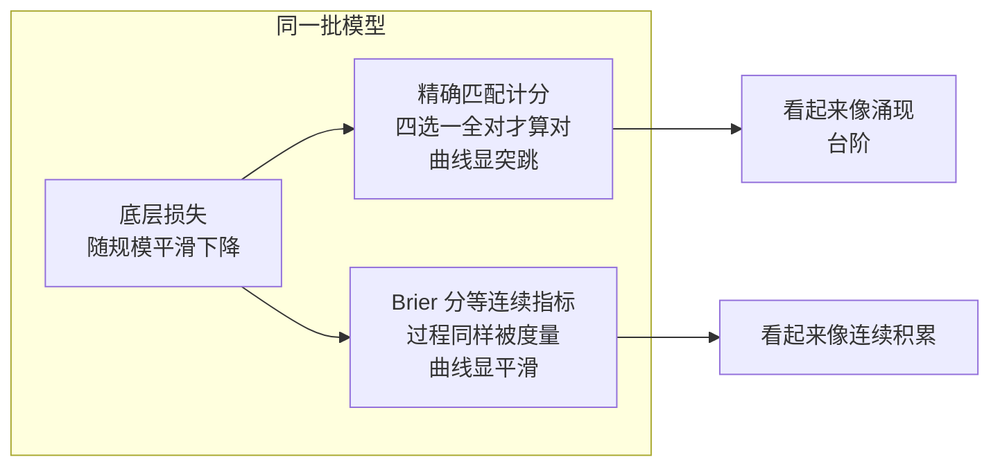

# 涌现能力与度量之争

## 核心结论

Wei 等人 2022 年定义「涌现能力」：某能力在模型规模低于阈值前接近随机水平，超过后突然出现，few-shot 指令跟随、多步算术、思维链推理都出现过这种形状 [[13]](#ref-13)。Schaeffer 等人 2023 年泼了有理有据的冷水：**阶跃可能是指标的产物** [[14]](#ref-14)。今天的共识接近「并存」——底层损失平滑，指标可能阶跃，两者不必矛盾。

图 1 同一能力在不同度量口径下的形状差

## 要点拆解

### 涌现的原始定义

规模低于某个阈值前接近随机水平，超过阈值后突然出现 [[13]](#ref-13)——这是个诱人的产业叙事，暗示存在「可规划的突破点」。

### 镜像论点： Mirage 论文的证据

Schaeffer 等人以 MMLU 为代表例子 [[14]](#ref-14)：

- **精确匹配计分**（四选一全对才算对）时，能力提升在曲线上表现为突跳；
- 换成 **Brier 分之类连续指标**，同一批模型的表现是平滑的。

即能力底层可能一直在连续积累，只是离散公尺把过程折叠成了台阶。

### 与幂律的张力及共识

涌现的阶跃叙事与规模定律的平滑曲线形成张力。共识是两者并存：**底层损失平滑，指标可能阶跃，两者不必矛盾**。实践含义：

- 把涌现当成可规划的突破点，风险很高；
- 把幂律当成规划的平均线，更稳妥。

### 下游转换不完全的另一面

预训练幂律本就不必然传导到下游：损失下降对下游指标的转换不完全，微调分布与预训练分布偏移时更甚；「预训练 loss 不动了所以到顶」与「换个指标出现巨大跃升」都可能是[[Scaling失效五边界|度量错觉]]。

## 相关页面

- [[预训练撞墙与下半场]]：同一争议的产业叙事面（旗舰增幅收窄是否真撞墙）。
- [[Scaling失效五边界]]：度量折叠能力是边界之五。
- [[大模型可解释性·素材摘要]]：从机制层看能力如何在参数中积累。
- [[规模定律]]：幂律定义与三大用途的上位页。
- [[Scaling Law·素材摘要]]：本页所在素材全篇索引。

## 参考来源

[[raw/papers/Scaling Law.md]]
