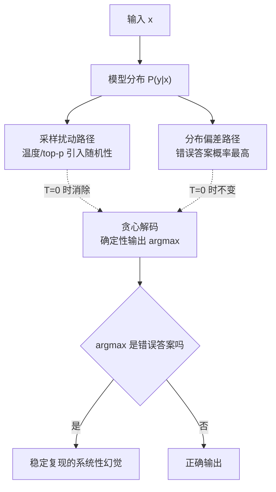

# 温度归零不消除系统性幻觉

## 核心结论

温度 $T\to 0$ 时解码退化为贪心（argmax），看似「最保守」，实则**只切断了采样扰动这一路，切不断分布偏差这一路**。若模型分布本身就把错误答案排在最高概率位，贪心解码会**确定性、可复现地**输出错误答案。

**结论：温度不是治理手段，它只能决定幻觉是偶发还是稳定出现。**

## 要点拆解

### 两条错误来源要分开

| 来源 | 机制 | T=0 的作用 |
|---|---|---|
| 采样扰动 | 温度/top-p 把生成引向低概率分支 | 消除 |
| 分布偏差 | 训练决定的 $P(y\mid x)$ 本身有偏 | **无效** |

温度调节只影响第一条。第二条在训练完成时已经固化在参数里，解码阶段无法改变。

### 这一结论的工程后果

「把温度调到 0 就不会幻觉了」是流传最广的误区。实际上，它只是**把偶发幻觉换成了稳定幻觉**——每次都错同一个答案，反而更难被偶然检查发现。

真正的治理必须进入 [[幻觉三层治理框架]] 的训练层与推理层。

### 与既有页面的衔接

[[温度参数与生成采样]] 给出了 $T\to 0$ 退化为 argmax 的机制本体；[[采样解码策略]] 说明贪心与采样的选择差异。本页则回答**这个选择能不能治幻觉**——不能。

## 相关页面

- [[大模型幻觉定义与本质]]：为什么分布会有偏。
- [[幻觉成因四条线]]：采样随机性与数据偏差的分线。
- [[幻觉归因提示词与模型分诊]]：本页是「模型主导」一侧的核心证据。
- [[温度参数与生成采样]]：温度机制本体。

## 参考来源

- [[raw/papers/大模型幻觉成因与分层治理.md]]
