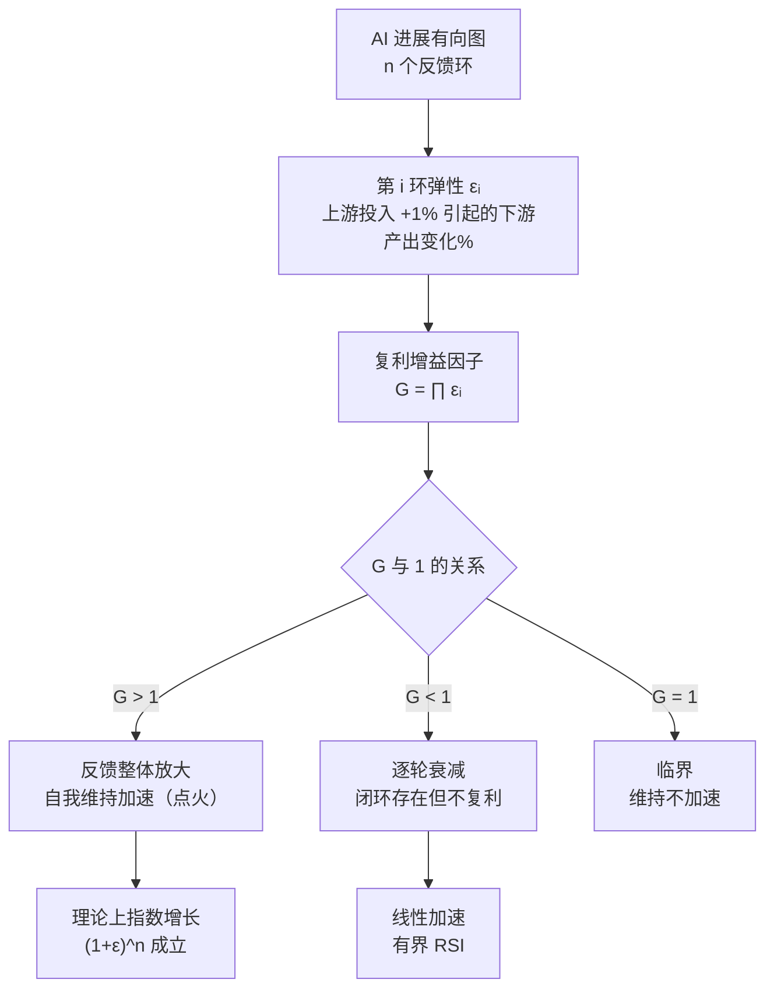

# 点火条件与复利因子G

## 核心结论

**点火条件是一条不等式：$G=\prod_{i=1}^{n}\epsilon_i > 1$。**

这是把「智能爆炸是不是会来」这个哲学问题，翻译成「各反馈环的弹性乘积有没有跨过 1」这个可估算问题的那一步。当前基于现有数据的估算显示：**反馈环尚不足自我维持加速，但正在增强**。

## 要点拆解

### 弹性 ε 的定义要读准

$$\epsilon_i = \frac{\text{下游产出的变化百分比}}{\text{上游投入的变化百分比}}$$

即**上游投入 +1% 所引起的下游产出变化百分比**。它衡量的是「这一环把投入放大还是缩小」。

判断方向：

| 情形 | 含义 | 对 RSI 的作用 |
|---|---|---|
| $\epsilon > 1$ | 放大：投一点，产出更多 | 正反馈 |
| $\epsilon = 1$ | 等比：投多少产多少 | 无增益 |
| $0 < \epsilon < 1$ | 衰减：投很多，产出少 | 负反馈 |

**多环相乘而不是相加**，是这套建模的关键：任意一环衰减到很低，都会把整体乘积压到 1 以下——这就是「整体受最慢环节锁住」的数学表达。

### 为什么是乘积：最慢环节定律

$$G=\prod_{i=1}^{n}\epsilon_i$$

乘积形式的含义：**n 个环节必须整体协同放大，才可能点火**。单点突破不够用。

这解释了 RSI 的一个现实困境——就算「代码生成」这一环弹性很高（AI 写代码确实快），只要「验证」「部署」「材料制造」这些环节弹性低，乘积照样被拉到 1 以下。物理与算力瓶颈正是这样一类低弹性环节：算法进步需要算力兑现、软件需要部署验证、材料需要制造测试，**系统整体被最慢环节锁住**。

### 与智能爆炸的对应关系

I. J. Good 1965 年的直觉是：每轮改进带来 $\epsilon$ 倍研发效率增益，则 $n$ 轮后能力为 $(1+\epsilon)^n$，$\epsilon>0$ 时指数增长。

**这个式子的成立前提正是 $G>1$。**

- $G>1$：指数增长具备充分条件，$(1+\epsilon)^n$ 的曲线成立；
- $G<1$：逐轮衰减，$(1+\epsilon)^n$ 只是形式上写得出来，实际被衰减因子吃掉。

所以「智能爆炸」在 $G<1$ 的现状下**不具备充分条件**，它仍是理论上限而非既成现实。这条推论统一解释了 [[有界RSI与开放式RSI]] 的核心判断：有界收益 ≠ 智能爆炸。

### 现行估算的读法与边界

素材明确说明：基于现有数据的「信封估算」显示当前反馈环尚不足自我维持加速，但正在增强。

读数时要注意三件事：

1. **是估算不是实测**——弹性难以直接测量，多为间接推断，量级可信、精确值不可信；
2. **「正在增强」比「当前值」更值得跟踪**——它意味着边界在移动，静态结论会过期；
3. **$G$ 不是常数**——随技术栈变化，今天 $G<1$ 不代表明年仍 $<1$。

【推导】由 $G$ 的乘积结构可推出：**提升 RSI 可行性最有效的路径，往往不是把最强的一环做得更强，而是补上最弱一环**。这是从素材形式化直接推得的工程含义，素材未明写。

## 相关页面

- [[有界RSI与开放式RSI]]：$G$ 是否大于 1 决定的分层。
- [[RSI四项判定标准]]：递归增益（第三条）的量化形式即本页。
- [[递归自我改进RSI]]：定义与形式化判据的起点。
- [[递归自我改进总览]]：本页所属的领域全景。

## 参考来源

- 线上原文：[https://arxiv.org/abs/2609.15802](https://arxiv.org/abs/2609.15802)（The Economics of Recursive Self-Improvement, 2026）
- 线上原文：[https://doi.org/10.1016/S0065-2458(08)60418-0](https://doi.org/10.1016/S0065-2458(08)60418-0)（I. J. Good 1965，智能爆炸原始设想）
- [[raw/papers/RSI递归自我改进.md]]（§2.2 智能爆炸假设、§3.4 点火条件的经济学建模）
