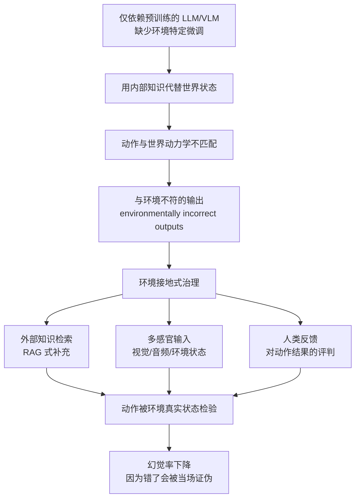

# 环境接地式幻觉治理

## 核心结论

环境接地式幻觉治理的命题很窄也很硬：**智能体越是只靠预训练模型的内部知识生成动作、越缺少环境特定微调，就越容易幻觉**——因为它把「模型以为的世界」当成了「世界的真实状态」。对策不是让模型说得更对，而是**让动作暴露在环境的真实检验下**。

它与 [[幻觉成因四条线]] 的关系是并列而非替代：那四条讲的是「知识怎么错的」，这一条讲的是「错误的知识被当成了当前状态」。

## 要点拆解

### 这条成因的机制

论文的表述可以拆成三步：

1. 智能体若只用预训练 LLM/VLM、少做环境微调，动作生成就完全依赖模型的内部知识库；
2. 内部知识是**训练时的世界近似**，不含部署环境的动力学（物体位置、界面状态、系统当前配置）；
3. 于是动作基于错误的当前状态计算，输出「与所处环境不符」——这不是事实错误，而是**状态错误**。

**这与「答错一个事实」不同：事实错误是知识缺陷，状态错误是感知缺失。** 前者靠补知识，后者只能靠接地。

### 视觉侧还有一条独立成因

对视觉语言生成，论文另指一条常见成因：**过度依赖训练数据中物体与视觉线索的共现关系**。模型学到的是「这些东西常一起出现」，而不是「这个场景里此刻有什么」，于是生成的描述与画面实际内容错位。

这条与 [[文档VLM三大范式]] 里端到端 VLM 的幻觉短板同源：都来自「用统计共现替代实际观察」。

### 三类接地手段的定位

论文把接地手段散在「推理增强」与「训练」两处，归拢后是三类：

| 手段 | 接地的是什么 | 生效时机 | 边界 |
|---|---|---|---|
| 外部知识检索（RAG 式） | 知识 | 推理时 | 只补知识截止，补不了状态感知 |
| 多感官输入 | 状态 | 推理时 | 依赖传感器质量与可用性 |
| 人类反馈 | 动作对错 | 训练时与推理时 | 成本高，无法覆盖高频动作 |

关键辨析：**RAG 不能替代环境接地**。RAG 让模型「知道得更多」，环境接地让模型「看清此刻」。前者对知识类幻觉有效，对状态类幻觉几乎无效——这条边界与 [[RAG幻觉治理边界]] 的结论一致。

### 在分层治理框架里的位置

[[幻觉三层治理框架]] 的训练层/推理层/系统层三分里，环境接地**横跨三层**，不属于任何单层：

- 训练层：把环境反馈做成训练信号（见 [[Agent训练方法阶梯]]）；
- 推理层：把环境状态注入上下文（多感官输入）；
- 系统层：动作用执行前校验兜底（见 [[Agent最小权利与审批门]]）。

这解释了它为什么容易被漏掉——**它不是某一层的补丁，而是一条需要三层配合的贯线**。

### 什么场景下这条最值得用

优先级排序：

1. **动作不可逆、代价高**（物理操作、生产环境变更、资金动作）——状态错误无处回滚；
2. **环境状态高频变化**（实时界面、动态场景）——训练时的世界近似必然过期；
3. **模型内部知识与部署环境差异大**（私有系统、专有术语体系）——预训练几乎不覆盖。

反过来，纯文本问答、静态知识检索这类任务，环境接地的收益有限，RAG 与拒答训练性价比更高。

## 相关页面

- [[幻觉成因四条线]]：数据偏差/采样随机/知识截止/压缩失真四条，与本页构成第五条。
- [[幻觉三层治理框架]]：本页横跨三层的落点所在。
- [[具身Agent与环境接地]]：接地在定义层的来源。
- [[AgentToken与下一动作预测]]：动作被环境证伪的机制载体。
- [[RAG幻觉治理边界]]：RAG 补什么、不补什么，与本页的分工边界。
- [[大模型幻觉技术全景总览]]：本页所属的领域全景。

## 参考来源

- 线上原文：[https://arxiv.org/abs/2401.03568](https://arxiv.org/abs/2401.03568)（§2.2.1 Hallucinations、§2.2.5 Inference Augmentation、摘要段）
- 本地备份：[[raw/papers/Agent-AI-Surveying-the-Horizons-of-Multimodal-Interaction.pdf]]