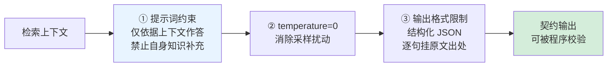

# 生成侧结构化约束

## 约束流程

## 核心结论

- **模型不是可信组件**：在 RAG 链路里，LLM 的职责是"把检索到的文本整理成答案"，不是"凭自身知识回答"。契约约束的是**行为边界**，不是提升智力。
- **输出格式限制是最强的一道**：强制模型输出"检索原文 + 出处"的结构化 JSON，让模型的每一句话都必须挂到某段原文上，**物理上阻断无据生成**。
- **三者是递进关系**：提示词约束是软约束（可被越狱/漂移破坏）、T=0 是确定性约束（消除采样层随机）、结构化输出是硬契约（可程序校验）。

## 要点拆解

### ① 提示词约束

要点：限定模型仅依据上下文作答，**显式禁止使用自身知识补充**。

这一条与 [[提示词注入根因分析]] 中的根因同源——模型无法天然分辨"系统指令"与"数据"，因此约束必须写进系统提示层，并用分隔符/结构化上下文把二者物理隔开，参见 [[结构化上下文]]、[[上下文分层组织]]。

**边界**：提示词是软约束。存在被越狱、被长上下文稀释、被工具返回内容污染的可能，因此不能作为唯一防线。

### ② temperature=0

要点：贪心解码消除采样随机性。

**必须同时记住的边界**：T=0 只切断采样扰动，切不断分布偏差——错误答案若在分布中已占高位，贪心解码会确定性输出错误，详见 [[温度归零不消除系统性幻觉]] 与 [[RAG绝对准确不可达]]。

### ③ 输出格式限制

要点：强制输出检索原文的结构化 JSON，阻断自主概括。

工程要点：

| 项 | 做法 |
|---|---|
| Schema | 每条内容带 `text`（引文原文）+ `source_id`（出处）+ 可选 `confidence` |
| 校验 | 用 JSON Schema 校验，解析失败即视为不可靠输出，转入检测或拒答 |
| 引用锚点 | `source_id` 必须指向召回候选集合内的真实 ID，不允许模型自由生成 ID |

结构化输出的价值与 [[结构化输出与Tool抑制]] 同源——都是把"模型自由生成"约束成"程序可解析的契约"。

## 常见误区

| 误区 | 正解 |
|---|---|
| 提示词写得够严谨就不需要格式约束 | 提示词是软约束，格式约束才是硬边界 |
| T=0 就能保证答案正确 | T=0 只消除采样扰动，分布偏差仍在 |
| 结构化输出只是格式美观 | 结构化输出是把"有无据"变成可程序判定的问题 |

## 相关页面

- [[RAG准确率保障体系]]：本页所属的架构层生成侧
- [[温度归零不消除系统性幻觉]]：T=0 的作用边界
- [[温度参数与生成采样]]：采样机制本体
- [[结构化输出与Tool抑制]]：结构化契约的通用机制
- [[上下文分层组织]]：指令与数据的物理隔离
- [[幻觉检测三条路径]]：契约输出后的检测路径
- [[RAG检索优化五层]]：生成之前的检索侧保障

## 参考来源

- [[raw/papers/RAG准确率提升.md]]