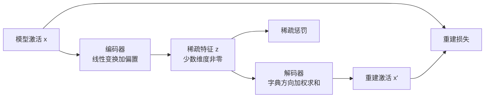

# 稀疏自编码

## 核心结论

稀疏自编码（sparse autoencoder，SAE）把激活映射到过完备字典再重建，目标是「重建得像、亮得少」——用远多于维度的稀疏基拆开叠加，让每个基向量尽量对应单一概念，回答 [[叠加与多义]] 留下的「直接读权重读不出语义」问题 [[4]](#ref-4)。

图 1 稀疏自编码器的编解码结构

## 要点拆解

### 经典形式与变体

经典写法用 ReLU 加 L1 惩罚：

$$z=\mathrm{ReLU}\left(W_e\left(x-b_d\right)+b_e\right),\qquad \hat{x}=W_d z+b_d$$

$$\mathcal{L}=\left\|x-\hat{x}\right\|_2^2+\lambda\left\|z\right\|_1$$

L1 有收缩偏差且稀疏强度难调，大模型上转向：

- **k-sparse**（OpenAI）：固定每个 token 的激活原子数，400 亿 token 训练 1600 万维字典，大规模下死特征仍很少 [[4]](#ref-4)；
- **JumpReLU**：带阈值的跳变函数替代 ReLU，同稀疏度下保真度优于 Gated 与 TopK [[9]](#ref-9)；Gemma Scope 按层开源这套权重，覆盖 Gemma 2 的 2B、9B 全层与 27B 部分层 [[10]](#ref-10)。

### 四个评估指标

| 指标 | 含义 | 判读方式 |
|---|---|---|
| L0 | 平均每个 token 激活的原子数 | 过小欠拟合，过大不稀疏 |
| 重建损失与损失恢复率 | 用 SAE 输出替换原激活后模型掉多少分 | 掉太多说明关键信息被漏掉 |
| 死特征比例 | 训练全程几乎不激活的原子 | 高则字典利用率低 |
| 自动解释得分 | 另一模型看激活样本猜含义再预测打分 | 只能作参考，不能作结论 |

表 1 稀疏自编码器核心评估指标

### 随机基线是必需品

自动解释得分最不可靠：Heap 等人把 SAE 训练在**随机初始化**的 Transformer 上，得分与重建指标竟和训练模型相近——高分不等于找到参与计算的特征，应把随机基线当常规对照，现有指标只是不充分的代理 [[11]](#ref-11)。

## 相关页面

- [[大模型可解释性]]：SAE 所属的机制层谱系（读原子）。
- [[叠加与多义]]：SAE 的问题起点。
- [[电路追踪]]：特征之上的连接层。

## 参考来源

[[raw/papers/大模型可解释性.md]]
