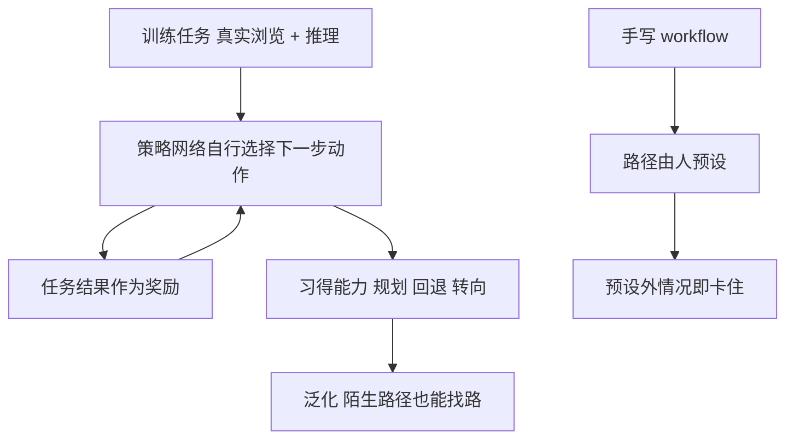

# 端到端强化学习研究

## 核心结论

Deep Research 最关键的机制差异在训练方式：官方口径明确说明使用**端到端强化学习**训练，训练任务即真实世界的浏览与推理任务。

通过训练，模型学会了三件事：规划多步轨迹、在无效路径上回退、根据实时读到的内容改变策略。

与手写 workflow 的本质差别是**泛化能力**，不是步骤多寡。

## 要点拆解

### 训练信号从哪来

| 环节 | 内容 |
|---|---|
| 训练任务 | 真实世界的浏览与推理任务，非固定语料库内的合成题 |
| 策略输出 | 下一步动作（搜索什么、打开哪页、是否继续） |
| 奖励来源 | 任务最终结果，而非中间步骤的逐步标注 |
| 习得效果 | 规划、回退、转向三类行为自发涌现 |

### 泛化为什么关键

手写流程能处理好预设场景，遇到未设计的路径即失效；端到端策略在异常情况下仍能自行找路。

这一差别在真实网页环境里被放大：固定语料库假设所有所需信息都在库内，而真实网页是嘈杂、动态、会变的。DeepResearcher 的结论是，**在真实环境训练是必要的而非可选的**。

### 独立佐证

官方自述之外，开源侧给出了对照实验：在真实网页环境做强化学习的方案，显著优于提示词工程基线与基于固定语料库的强化学习方案。具体收益与三条开源路线见 [[DeepResearch开源复现]]。

### 这不是「多跑几轮」

一个常见误解是把 Deep Research 等同于「让模型多检索几次」。差别在于策略是否被训练过：未被训练的多轮检索只是重复同样的错误动作，被训练的策略会在读到反证时改变方向。

## 相关页面

- [[Deep Research定义]]：被训练的能力是什么
- [[DeepResearch开源复现]]：DeepResearcher / WebThinker / ASearcher 三条落地路线
- [[DeepResearch与RAG分野]]：路径归属的差异
- [[Agent训练方法阶梯]]：训练方式的层级视角
- [[DeepResearch总览]]：领域入口页

## 参考来源

- [[raw/papers/Deep Research.md]]
