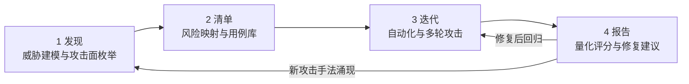

# 红队测试四步闭环

## 流程总览

<b>图1 红队测试的四步闭环流程</b>

## 核心结论

- **红队测试是嵌入 AI 开发生命周期的持续对抗循环，而非一次性事件**，可拆解为发现、清单、迭代、报告四个阶段[[4]](#ref-4)[[5]](#ref-5)。
- 四个阶段分别解决「打哪里」「用什么打」「怎么规模化地打」「打完后怎么量化与修复」，缺任一步红队结论都难以复用或回归。
- 报告阶段同时接到两条回路：修复后回归迭代、新攻击手法涌现时回到发现——这正是[[红队测试边界与军备竞赛]]所说的「军备竞赛」在流程上的体现。

## 要点拆解

| 阶段 | 核心动作 | 关键产出 | 代表方案 |
|---|---|---|---|
| ① 发现 | 梳理用户角色、输入通道、工具集成、检索数据源、Agent 权限等入口，明确资产与对手画像，预先定义「什么算确认漏洞」 | 威胁模型、攻击面清单 | Anthropic 红队报告：威胁模型清晰度决定后续覆盖效率 |
| ② 清单 | 建立结构化攻击用例库：越狱模板、间接注入载荷、毒性触发语料、偏见探测集、Agent 场景攻击 | 风险覆盖度基线 | 以 OWASP LLM 十大风险作为覆盖度基线[[2]](#ref-2) |
| ③ 迭代 | 以自动化攻击驱动规模化发现 | 大规模攻击样本 | [[GCG对抗攻击]]、红队语言模型、[[PyRIT]] |
| ④ 报告 | 输出失败模式分类、攻击成功率、严重程度分级、可复现路径、根因与防御建议 | 量化报告与修复建议 | 回流到训练数据修订、系统提示调整、护栏加固 |

- 第四步结论回流后形成「红队—蓝队—训练」三方协同的持续对抗循环。

## 相关页面

- [[AI安全与红队测试总览]]：本页所在的上位总览
- [[三大威胁向量]]：发现与清单阶段要覆盖的攻击面
- [[GCG对抗攻击]]、[[PyRIT]]：迭代阶段的自动化攻击与编排
- [[红队量化指标ASR与URR]]：报告阶段的量化指标
- [[红队实现方式对比]]：各阶段可选的实现方式
- [[Prompt注入验证与运营]]：注入侧的「红队→修复→监控」闭环（既有沉淀）

## 参考来源

- [[raw/papers/AI安全与红队测试.md]]

---

[2] OWASP Foundation. [OWASP Top 10 for LLM Applications v2.0](https://genai.owasp.org/llm-top-10/) *genai.owasp.org*, 2025.
[4] D. Ganguli et al. [Red Teaming Language Models to Reduce Harms](https://arxiv.org/abs/2209.07858) *arXiv:2209.07858*, 2022.
[5] E. Perez et al. [Red Teaming Language Models with Language Models](https://arxiv.org/abs/2202.03286) *EMNLP*, 2022.
