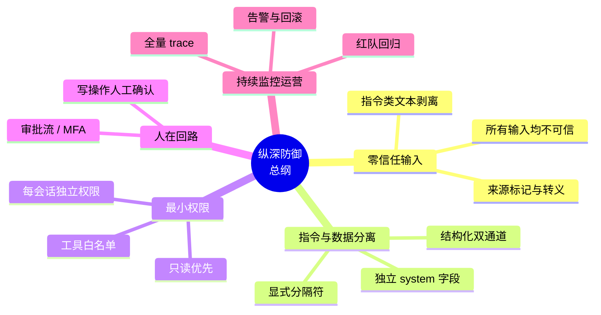

# 纵深防御五原则

## 核心结论

- 五条原则是**并行互补**关系，共同构成纵深防御，而非层层派生。
- 唯一可靠的路线是**架构分离**：确保 Agent 不同时具备"处理不可信输入、拥有写权限、访问机密信息"三者。

## 五原则全景

<b>图1 纵深防御五原则</b>

## 原则速查

| 原则 | 一句话定义 | 关键动作 | 拦截的攻击阶段 |
|---|---|---|---|
| 零信任输入 | 所有输入均视为不可信 | 来源标记、转义、规范化 | 注入进入上下文前 |
| 指令与数据分离 | 使数据在结构上不可能被解释为指令 | 分隔符、双通道、Spotlighting | 注入生效时 |
| 最小权限 | 即使注入成功也无利可图 | 白名单、只读优先、token 隔离 | 注入造成损害时 |
| 人在回路 | 不可逆动作可被否决 | 写操作审批流、MFA | 损害发生前 |
| 纵深防御 | 不依赖单一措施 | 六层联动 | 全过程 |

## 相关页面

- [[Prompt注入根因分析]]：为什么需要这五条原则
- [[Prompt注入分层防御体系]]：五原则在六层防御中的落地
- [[LLM权限最小化]]：最小权限原则的具体实践
- [[输出验证与人工审批]]：人在回路原则的出口把关

## 参考来源

- [[raw/papers/Prompt注入与防范.md]]
