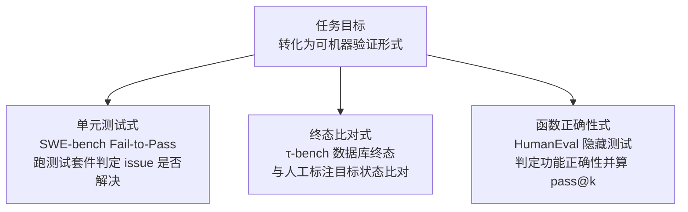

# 结果评估

## 三类 code-based 实现

<b>图1 结果评估的 code-based 实现三类</b>

## 核心结论

- 结果评估只看**最终输出或终态**是否达标，如答案正确性、数据库终态一致性、测试是否通过。
- 核心方法路径是 code-based——**把任务目标转化为可机器验证的形式**，在可验证域内完全可靠。
- 它的短板同样明确：对**「蒙对」**（过程胡乱但答案正确）与**「违规但结果正确」**完全失明，因此必须与 [[轨迹评估]] 配对使用。
- 工程上它是唯一可以大规模、低成本自动跑的评估形态，适合做 CI 硬门槛与回归（见 [[持续评估]]）。

## 要点拆解

| 实现 | 代表基准 | 判定方式 |
|---|---|---|
| 单元测试式 | SWE-bench（2,294 个真实 GitHub issue） | 从真实 PR 抽取 Fail-to-Pass 测试，Agent 提交 patch 后运行测试套件判定 issue 是否解决 |
| 终态比对式 | [[τ-bench]] | 把 Agent 工具操作后的数据库终态与人工标注目标状态比对一致性 |
| 函数正确性式 | HumanEval | 对生成代码执行隐藏测试判定功能正确性，并据此计算 [[pass@k与pass^k]] |

- **优势**：实现简单、可自动化、适合大规模回归；**劣势**：无法评估开放文本，判不了「过程对不对」。
- 与 `LLM-as-a-Judge` 的分工是「能枚举验证的交给代码，开放输出交给裁判」，详见 [[LLM-as-a-Judge]]。

## 相关页面

- [[轨迹评估]]：评估对象的另一半，评过程
- [[τ-bench]]：终态比对式结果评估的代表基准
- [[Agent评估体系总览]]：结果评估在五层结构中的位置
- [[四类评估方法对比]]：结果评估与三类裁判方法的横向对比
- [[pass@k与pass^k]]：由结果评估产出的成功率指标
- [[大模型兜底层]]：任务拆解后由工具执行、再对终态取证的工程形态

## 参考来源

- [[raw/papers/Agent轨迹评估和结果评估.md]]
