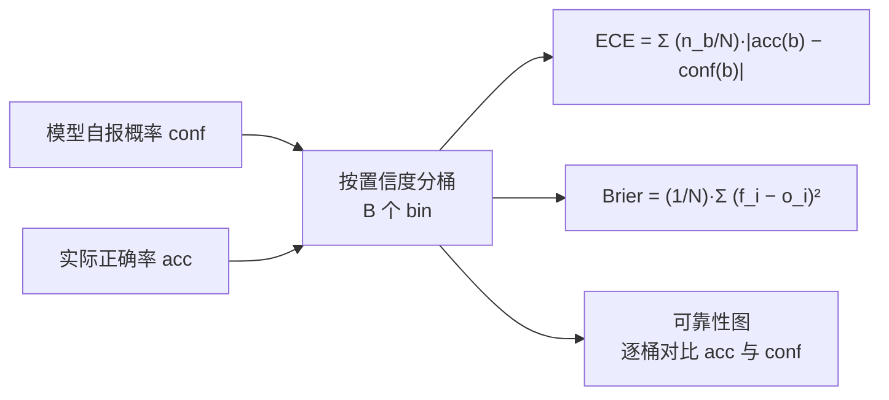

# 置信度校准与ECE

## 机制

<b>图1 校准的度量与可视化</b>

## 核心结论

- **校准（信心可信）的核心是度量「自报概率与实际正确率」的偏离**[[大模型评测可信·素材摘要]]，两个常用指标为**期望校准误差（Expected Calibration Error, ECE）**与**布里尔分数（Brier Score）**：

$$\mathrm{ECE} = \sum_{b=1}^{B}\frac{n_b}{N}\left|\mathrm{acc}(b)-\mathrm{conf}(b)\right|$$

$$\mathrm{BS} = \frac{1}{N}\sum_{i=1}^{N}(f_i - o_i)^2$$

其中 $B$ 为置信度分桶数，$n_b$ 为第 $b$ 桶样本数，$f_i$ 与 $o_i$ 为第 $i$ 个样本的预测概率与真实结果；分桶后各桶准确率与置信度的差距可用**可靠性图（Reliability Diagram）**直观呈现。
- **过度自信是评测失信的直接来源**：模型报「很确定」却错了时，下游无法区分「高置信错误」与「真知」，分数因此失真；基座模型在 MMLU 上条件概率校准良好，但**经后训练（RLHF）后明显退化** —— GPT-4 技术报告给出基座模型 ECE **0.007**、RLHF 后 **0.074** 的对照数据。
- 校准不是可选项：一个分数漂亮但校准崩坏的模型，在需要按置信度分流（自动执行 vs 转人工）的系统里无法安全使用。

## 要点拆解

- **两个指标的分工**：ECE 直接刻画「分桶后准确率与置信度的加权平均偏离」，可解释性强；Brier Score 是概率预测的均方误差，同时对分辨力与校准敏感，适合作为单一标量对比。
- **ECE 的已知弱点**：分桶数与分桶边界会显著影响数值，跨论文比较 ECE 时必须核对分桶设置；可靠性图比单一 ECE 更能暴露是「整体偏移」还是「某段过度自信」。
- **恢复手段**：工程上让模型对**多次采样答案语言化置信度**，可使 RLHF 模型的置信度与正确率显著对齐[[语言化置信度]]；评委层面同样需用 ground truth 锚例持续回归（见[[人工评估与裁判校准]]）。
- **与其他评估指标的关系**：准确率回答「对不对」，校准回答「知不知道自己可能不对」，二者是评测信心可信缺一不可的两面；在 [[Agent评估体系总览]] 的七项维度里，校准对应的是「安全与合规」与「鲁棒性」所依赖的置信基础。

## 相关页面

- [[语言化置信度]]：恢复 RLHF 模型校准的工程手段
- [[人工评估与裁判校准]]：以人工锚例校准评委（弱者效应对应的锚点机制）
- [[大模型评测可信体系总览]]：信心可信支线在四支柱中的位置
- [[持续评估]]：校准退化需在版本迭代中持续回归监测
- [[大模型评测可信·素材摘要]]：素材出处

## 参考来源

- [[raw/papers/大模型评测可信.md]]
