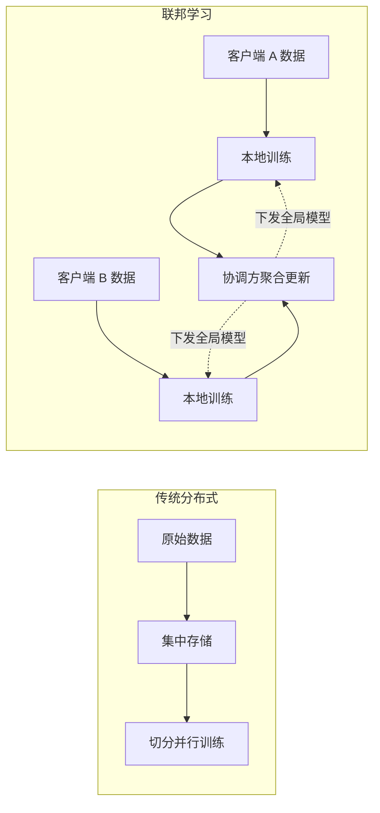

# 联邦学习

## 核心结论

联邦学习（Federated Learning, FL）指多个持有本地数据的客户端在服务方协调下协作求解同一机器学习问题，**客户端对数据保持完全控制，原始数据不出域，仅交换模型参数或更新**。

与分布式学习的分水岭不在计算框架，而在**数据是否移动**：传统做法是数据先集中再切分计算，联邦学习是数据不动、把计算送到数据所在地。

## 要点拆解

### 与分布式学习的范式分野

| 维度 | 传统分布式学习 | 联邦学习 |
|---|---|---|
| 数据流向 | 先集中，再切分 | 不集中，计算下沉到数据侧 |
| 隐私来源 | 环境隔离（可信集群） | 密码学与扰动机制保障 |
| 首要瓶颈 | 算力与调度 | 通信（移动网络带宽稀缺） |
| 失败模式 | 节点故障 | 掉队者、异构、上传泄露 |

这一分野带来两个额外约束：隐私必须由机制保障（不只是「没上传原始数据」），通信成为首要瓶颈。

### 系统成立的约束条件

| 约束 | 含义 | 失效后果 |
|---|---|---|
| 数据不出域 | 原始样本不上传，只交换更新 | 隐私前提被破坏 |
| 隐私可量化 | 具备 (ε,δ)-差分隐私或安全聚合等可证明机制 | 「没上传」不等于「没泄露」 |
| 通信可行 | 轮次与带宽能适配移动网络 | 训练无法收敛或成本失控 |
| 容忍异构 | 允许算力、网络、数据分布不一致 | 掉队者拖垮整体进度 |

前两条对应隐私，后两条对应工程现实——这也是联邦学习论文总在「隐私」与「效率」间权衡的根因。

### 三类划分

| 类型 | 数据重叠 | 切分方式 | 典型场景 |
|---|---|---|---|
| 横向联邦 | 样本不同、特征相同 | 按样本切分，聚合用加权平均 | 多家银行做同类风控 |
| 纵向联邦 | 样本相同、特征互补 | 按特征切分，需先做样本对齐 | 银行与电商联合建模 |
| 联邦迁移 | 样本与特征均不重叠 | 借迁移学习对齐表示空间 | 跨地区、跨业务知识迁移 |

详见 [[横向联邦与纵向联邦]]。

## 相关页面

- [[联邦学习总览]]：本页所属的领域全景。
- [[FedAvg联邦平均]]：最基础的聚合算法。
- [[安全聚合SecAgg]]：解决「服务器不可信」的机制。
- [[差分隐私]]：解决「输出可被推断」的机制。
- [[梯度泄露攻击]]：为什么「不上传数据」仍会泄露。
- [[横向联邦与纵向联邦]]：三类划分的横向对比。

## 参考来源

- [[raw/papers/联邦学习.md]]（§1 定义与分类）
- 线上原文：[https://arxiv.org/abs/1602.05629](https://arxiv.org/abs/1602.05629)（McMahan 等，2016）
