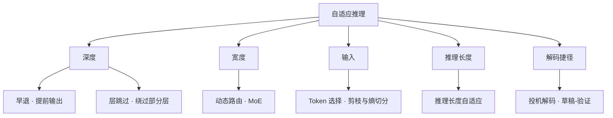

# 自适应推理

## 核心结论

标准 Transformer 对每个 token 施加统一计算，而输入难度实际差着量级——简单 token 被过度计算（overthinking），难题又计算不足，病灶是双向浪费。自适应推理用难度信号驱动算力增减，在深度、宽度、输入与推理长度四个维度按需伸缩，并以投机解码开辟解码捷径；其价值不是追求单点最优，而是把精度与效率的权衡曲线整体向外推，即帕累托前沿的改善。最大的风险不是变慢，而是判断器失准带来的静默掉点。

图 1 自适应推理按「什么被自适应」的谱系划分

## 要点拆解

### 与普通效率优化的分野

效率优化关注「缩短」，自适应关注「按需伸缩」——简单的问题该快就快，难的问题该堆就堆。可形式化为策略优化问题：在任务性能与计算成本的双目标下学习分配策略 [[1]](#ref-1)。

### 五类方法与一条捷径

| 维度 | 方法 | 代表 |
|---|---|---|
| 深度 | [[早退]]（提前终止） | CALM [[1]](#ref-1) |
| 深度 | [[层跳过]]（绕过） | Mixture-of-Depth [[2]](#ref-2) |
| 宽度 | [[动态路由]] | Switch Top-1 [[3]](#ref-3) |
| 输入 | [[Token选择]] | BLT 熵切分 [[4]](#ref-4) |
| 长度 | [[推理长度自适应]] | 强化学习停止策略 [[5]](#ref-5) |
| 解码 | [[投机解码]] | Speculative Sampling [[7]](#ref-7) |

### 实现范式

训练派（RL 策略 / SFT 内化 / 轻量控制器）上限高但要数据与训练资源；免训练派（prompt 控深 / 反馈终止 / 模块组合）零成本上线，上限受制于底座能力。对照见 [[训练派与免训练派对比]]。

### 应用场景

边缘与端侧推理（移动端 LLM 与车载）、LLM 服务降本（避免简单查询产生冗长思维链，直接砍推理账单）、实时决策系统（延迟约束下简单情形快速通过）。

## 相关页面

- [[早退]]、[[层跳过]]、[[动态路由]]、[[Token选择]]、[[推理长度自适应]]：五类方法原理页。
- [[投机解码]]：不改变模型本身的解码捷径，工业落地最广。
- [[难度信号]]：驱动一切增减决策的输入。
- [[自适应评测要点]]：帕累托两层报告与评测误区。
- [[自适应失效模式]]：静默掉点等边界风险。
- [[推理时扩展]]：上游主题，本页是其「按需分配」轴的深化。
- [[自适应推理·素材摘要]]：本素材全篇要点索引。

## 参考来源

[[raw/papers/自适应推理.md]]
