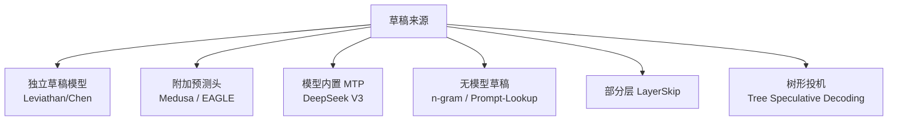

# 草稿模型分类

## 核心结论

草稿的类别决定了投机解码方案的成本、接受率与适用场景。主流分为**六类**：独立草稿模型、附加预测头（Medusa/EAGLE）、模型内置 MTP、无模型草稿、部分层 LayerSkip、树形投机。

## 六类草稿方案

### 4.1 独立草稿模型

用同家族的较小模型作草稿（如 Llama-8B 草稿 → Llama-70B 目标），代表是 Leviathan 与 Chen 的原始方案 [[1]](#ref-1) [[2]](#ref-2)。

- **优点**：零额外训练、开箱即用。
- **代价**：要求草稿与目标**共享同一词表**，并需常驻部署小模型、占用显存。
- **适用**：草稿质量要求高、可接受额外显存成本的场景。

### 4.2 附加预测头 Medusa 与 EAGLE

不引入独立小模型，从目标模型自身加推断头作草稿：

- **Medusa**：在模型头部加多个并行 decoding head、一次预测多个未来 token。
- **EAGLE 系列**：复用目标特征做特征级自回归。EAGLE-2 引入动态树形草稿，EAGLE-3 改为直接 token 预测并融合多层特征。

这类**自投机**省去独立小模型部署，是稠密模型的高性价比选择。当前 vLLM 的投机解码核心支持已转向 EAGLE 等，Medusa 主导地位相对衰退 [[3]](#ref-3)。

### 4.3 模型内置 MTP

部分架构在训练时就内置**多 token 预测**（Multi-Token Prediction, MTP），目标模型带一个 MTP 头、推理时直接用作草稿。代表为 **DeepSeek V3**、腾讯混元，官方即插即用、零额外部署，是 **MoE 模型的首选** [[4]](#ref-4)。

### 4.4 无模型草稿

完全不引入模型，通过 **n-gram 或 Prompt-Lookup** 从历史序列、已有 prompt 或检索结果中直接查下一步候选。

- **优点**：零部署、零显存增量。
- **适用**：摘要、RAG、代码编辑等高重复强规律文本。
- **缺点**：依赖文本规律性，自由生成内容收益有限。

### 4.5 部分层 LayerSkip

用大模型前若干浅层作草稿、全层做验证，节约独立草稿模型的部署，依赖层间协同完成草稿与验证的配合。

### 4.6 树形投机

草稿候选可从链式升级为**树形投机**（Tree Speculative Decoding）：一次生成多个分支的候选，用**树注意力掩码**在目标模型一次前向中并行验证整棵树，显著提高单次验证的接受率。代价是需用树形掩码管理 token 间依赖、工程更复杂，现为提升接受率的主流手段。

## 选型速览

- **MoE 且自带 MTP**：直接用内置 MTP。
- **稠密模型追求高性能**：用 EAGLE-2/3。
- **高重复强规律文本**：用 n-gram/Prompt-Lookup 零成本方案。
- **有同族小模型**：可用独立草稿模型。

## 相关概念

- [[投机解码]]：机制总览
- [[期望接受长度]]：草稿质量对收益的量化管理
- [[Medusa]]：附加预测头方案
- [[EAGLE]]：特征级自回归方案
- [[MTP多Token预测]]：模型内置方案
- [[投机解码工程落地]]：引擎支持与选型落地

## 参考来源

- [[raw/papers/投机解码.md]]

[1] Y. Leviathan et al. "Fast Inference from Transformers via Speculative Decoding." *ICML*, 2023.
[2] C. Chen et al. "Accelerating Large Language Model Decoding with Speculative Sampling." *arXiv:2302.01318*, 2023.
[3] vLLM Project. "Speculative Decoding (vLLM Docs)." *vLLM Documentation*, 2025.
[4] nebius. "MTP-DeepSeek-V3-0324 (Model Card)." *Hugging Face*, 2025.