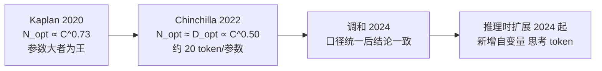

# 规模定律

## 核心结论

规模定律（Scaling Law）刻画语言模型损失随参数量 N、数据量 D 与计算量 C 的幂律下降，形式为 $L(N) = L_\infty + A \cdot N^{-\alpha}$ 与 $L(N, D) = E + \frac{A}{N^{\alpha}} + \frac{B}{D^{\beta}}$ [[1]](#ref-1)。公式里有三类参数：缩放指数（α 与 β，曲线的陡峭程度，是整条定律的灵魂）、不可约损失（$L_\infty$ 与 E，语言本身的熵）、前置系数（A、B，换算具体架构与数据）。注意这里的损失是语言建模交叉熵，不是应用里感受到的「回答好不好」，两者换算并不透明。

图 1 规模定律演进时间线

## 要点拆解

### 两大幂律特性

- **收益递减**：Kaplan 估计参数指数 α 约 0.076，参数翻倍损失只降约 5%；想让超额损失项减半，参数要约九千倍【推导】。每一分钱换到的性能都在变少，但一直换得到；
- **可外推**：幂律跨数量级平滑，可先训一批小模型（Kaplan 实验覆盖 768 到 15 亿参数）[[1]](#ref-1)[[3]](#ref-3)，拟合指数与系数后外推大模型表现。合起来一句话：**它把一份昂贵的未来实验，压缩成一批便宜的现在的小实验**——这是它超越所有单点经验贡献的根本原因。

### 为什么需要 Scaling Law（三大用途）

- **训练前预测**：数千万美元级的开训决策，先用小模型拟合曲线外推预期损失，判断值不值得投入（见 [[训练前预测与算力配比]]）；
- **资源最优分配**：给定算力预算，按 N_opt 与 D_opt 闭式解决定钱给模型还是数据，GPT-3 系与 LLaMA 系的路线分歧本质是对同一曲线不同位置的押注（见 [[Kaplan与Chinchilla定律]]）；
- **路线与资本依据**：年度算力预算、GPU 需求与融资叙事都由它背书（见 [[预训练撞墙与下半场]]）。

三条用途共用同一条曲线，也一并承接它的[[Scaling失效五边界|失效边界]]。

### 经验规律而非第一性原理

它是对特定架构（Transformer）、特定数据、特定训练流程的曲线拟合——换架构、换数据处理方式，指数和系数都会变。正因为可修，2022 年的 Chinchilla 修正才有意义；引用任何 scaling 数字前先确认口径与拟合条件。

## 相关页面

- [[Kaplan与Chinchilla定律]]：两大经典定律的对照、口径调和与两条产业路线。
- [[训练前预测与算力配比]]：C ≈ 6ND 与 N_opt/D_opt 闭式解的工程落地。
- [[数据受限扩展]]：重复数据收益上限与质量配比。
- [[MoE缩放律]]、[[临界批大小与超参迁移]]：架构与超参两个维度的分支。
- [[涌现能力与度量之争]]、[[预训练撞墙与下半场]]：曲线的张力面与撞墙叙事。
- [[稳定性与Muon优化器]]、[[Scaling失效五边界]]：训练现实与引用纪律。
- [[训练与推理时Scaling对比]]：第二自变量出现后的经济学对比。
- [[推理时扩展]]：推理时扩展的上位概念页。
- [[Scaling Law·素材摘要]]：本页所在素材全篇索引。

## 参考来源

[[raw/papers/Scaling Law.md]]
