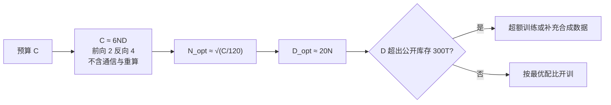

# 训练前预测与算力配比

## 核心结论

规模定律最直接的工业价值是**在训练之前知道训练能得到什么**：用最终预算的零头训一批小模型，拟合指数与常数，外推目标规模的预期损失 [[1]](#ref-1)[[4]](#ref-4)；给定总算力 C，Chinchilla 配方给出闭式解 N_opt ≈ √(C/120)、D_opt ≈ 20N [[4]](#ref-4)。公式的力量在于展示约束——以 2028 年为镜，限制不是「养不起大模型」，而是「养不起最优配比的大模型」。

图 1 给定算力预算的分配与库存校验

## 要点拆解

### 训练前预测

- 动辄数千万美元级的开训决策，先用小模型拟合曲线，外推目标规模的损失水平 [[1]](#ref-1)[[4]](#ref-4)；
- 把 μP（见 [[临界批大小与超参迁移]]）一并纳入，小模型实验的结果才能真正指导大模型配置；
- 外推错了，等于把千万美元级的学费交在起点。

### 计算量近似与分配闭式解

- **C ≈ 6ND**：前向 2 次、反向 4 次；不含通信与重算，两者会放大偏移【推导】；
- **N_opt ≈ √(C/120)，D_opt ≈ 20N**：Chinchilla 配方的工程形式 [[4]](#ref-4)，即 20 token/参数比。

### 2028 的算术（库存校验实例）

以 Epoch 预计 2028 年可能达到的 5×10²⁸ FLOPs [[16]](#ref-16) 代入最优配比【推导】：

- 最优参数约 20 万亿，配对数据约 410 万亿 token；
- 超出公开人类文本约 300T 的库存 [[16]](#ref-16)。

**若不突破文本库存，2028 年的限制不是「养不起大模型」，而是「养不起最优配比的大模型」。** 这正是 [[数据受限扩展]]（重复、过滤、混合）与 [[预训练撞墙与下半场]] 反方回应（合成、合同获取、多模态）能改变决策的地方。

### 两条产业路线的位置选择

闭式解给出的是「算力给定的最优点」，但站在曲线哪个位置经营是商业决策——OpenAI 系押上限优先，LLaMA 系主动超额训练换推理成本摊销，见 [[Kaplan与Chinchilla定律]]。

## 相关页面

- [[规模定律]]：幂律定义与三大用途的上位页。
- [[Kaplan与Chinchilla定律]]：闭式解来源与口径调和。
- [[数据受限扩展]]：D 超库存时的两条腿。
- [[预训练撞墙与下半场]]：300T 倒计时的完整攻防。
- [[临界批大小与超参迁移]]：μP 使外推实验可迁移。
- [[Scaling Law·素材摘要]]：本页所在素材全篇索引。

## 参考来源

[[raw/papers/Scaling Law.md]]
