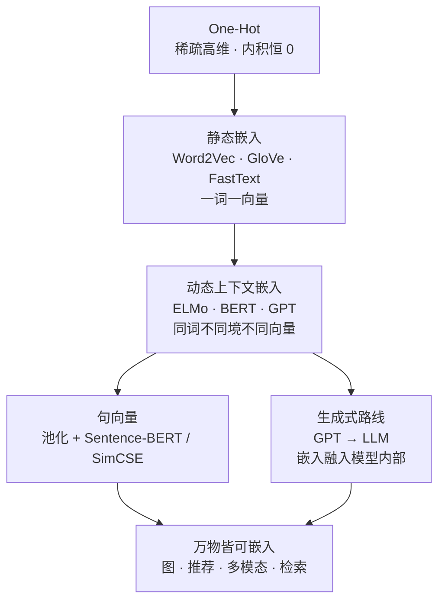

# 词嵌入

## 核心结论

词嵌入把 One-Hot 的稀疏高维向量映射为低维稠密连续向量（通常 50 至 300 维），使「猫」「狗」这类语义相近的词获得相近向量；理论依据是 1957 年 Firth 提出的分布式假设——上下文相似的词，语义也相似 [[1]](#ref-1)。它解决了 One-Hot 的三大缺陷，解剖几何从词走向万物。

图 1 从 One-Hot 到万物嵌入的表示学习演进谱系

## 要点拆解

### One-Hot 的三大缺陷

- **维度灾难**：实际词表常达 10 万以上，维度巨大，存储与计算成本高；
- **稀疏性**：向量几乎全为 0，不适合作为神经网络输入；
- **语义鸿沟**：最本质的问题，任意两个 One-Hot 向量内积恒为 0，「猫」和「狗」与「猫」和「汽车」在数学上同等无关。

### 类比推理性质

训练良好的词嵌入满足 king − man + woman ≈ queen，国家与首都（北京之于中国正如东京之于日本）、动词时态等语义关系都呈现规律的向量偏移 [[3]](#ref-3)。

### 相似度度量

| 度量 | 公式 | 特点 |
|---|---|---|
| 余弦相似度 | cos(θ) = u·v/(‖u‖‖v‖) | 只看方向，不受向量长度影响，最常用 |
| 欧氏距离 | ‖u−v‖₂ | 直观，但受维度增长影响 |
| 点积 | u·v | 计算最快 |

工程等价关系：对向量做 L2 归一化后，点积与余弦相似度完全等价，这是向量数据库常用点积实现余弦检索的原因。

## 相关页面

- [[Word2Vec]]、[[GloVe]]、[[FastText]]：三类静态嵌入方法。
- [[静态嵌入方案对比]]：三方案与传统矩阵分解的横向对照。
- [[动态上下文嵌入]]：ELMo/BERT/GPT 接力的上下文革命。
- [[句向量与池化策略]]：token 级向量升维到句子级。
- [[词嵌入工程选型]]：获取方式、超参经验值与决策流程。
- [[万物皆可嵌入]]：图、推荐、多模态与检索的泛化。
- [[Embedding与位置编码]]：模型内部嵌入层的对偶视角。
- [[词嵌入·素材摘要]]：本页所在素材全篇索引。

## 参考来源

[[raw/papers/词嵌入.md]]
