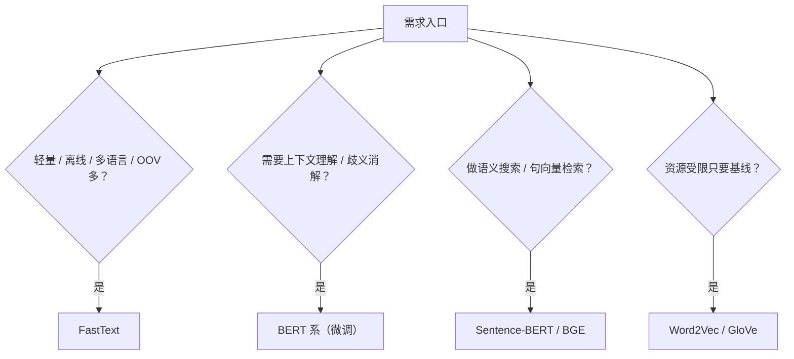

# 词嵌入工程选型

## 核心结论

工程选型按四步走：先按场景选获取方式（多数情况直接下载或库调用，领域差距大再微调），再按经验值起步调参（300 维、窗口 5~10、负采样 5~20），检索前记得 L2 归一化，最后按需求分支选模型——轻量多语言选 FastText、上下文理解选 BERT 系、语义检索选 Sentence-BERT/BGE、资源受限只要基线选 Word2Vec/GloVe。

图 1 词嵌入与句向量模型选型决策流程

## 要点拆解

### 获取方式

| 方式 | 适用场景 |
|---|---|
| 直接下载预训练向量 | GloVe、fastText 官方提供多语言向量 |
| 库调用 | gensim（Word2Vec）、HuggingFace Transformers（BERT 系） |
| 领域微调 | 通用向量在医疗、法律等领域效果不佳时 |
| 从头训练 | 仅当领域非常特殊且语料充足时 |

### 超参数经验值

- 向量维度：300 是经典默认值；
- 窗口大小：5~10；负采样数：5~20；
- 数值细节：在检索或计算余弦相似度之前做 L2 归一化——配合点积可直接复用更快的距离实现（归一化后点积与余弦等价，见 [[词嵌入]]）。

### 向量存储与检索

大规模嵌入检索依赖向量数据库（Faiss、Milvus、Qdrant、Pinecone）与 ANN 算法：HNSW（图索引，高召回低延迟）、IVF（倒排文件索引）、PQ（乘积量化压缩）。

## 相关页面

- [[词嵌入]]：度量基础与归一化等价关系。
- [[静态嵌入方案对比]]：FastText/Word2Vec/GloVe 选型依据。
- [[句向量与池化策略]]：语义检索侧句向量来源。
- [[向量数据库]]、[[HNSW图索引]]、[[IVF倒排索引]]、[[PQ乘积量化]]：存储与 ANN 加速的全家桶。
- [[Embedding向量嵌入]]：检索侧视角的姊妹页。
- [[词嵌入·素材摘要]]：本页所在素材全篇索引。

## 参考来源

[[raw/papers/词嵌入.md]]
