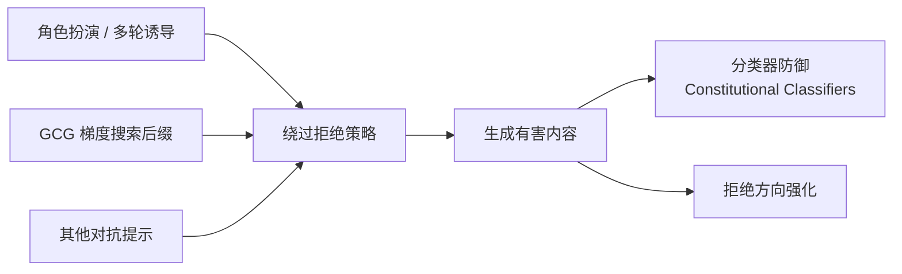

# 越狱攻击

## 核心结论

- **越狱指精心构造输入，使模型完全无视自身安全协议**，从而生成平时会被拒绝的有害内容[[2]](#ref-2)。
- 它在概念上是[[三大威胁向量]]中提示注入的特例——OWASP 直接将其定义为「使模型忽略安全协议的提示注入形式」；差别在于越狱更聚焦「绕过策略」，而不一定夺取控制权。
- 越狱是[[红队测试四步闭环]]里最主要的攻击样本来源之一，其难度并非随模型规模自动提升（见[[红队测试边界与军备竞赛]]）。

## 攻击与防御

<b>图1 越狱攻击路径与两类防御</b>

- **典型手段**：角色扮演、多轮诱导，以及 [[GCG对抗攻击]] 这类自动化生成的对抗后缀。
- **典型危害**：武器制造、非法活动指导等本应被拒绝的有害内容。
- **防御方向**：拒绝方向强化（在表征/训练层面加固「拒绝」）与分类器防御——代表方案见 [[Constitutional Classifiers]]，其部署前经 3000+ 小时人类红队验证。

## 相关页面

- [[AI安全与红队测试总览]]：本页所在的上位总览
- [[三大威胁向量]]：越狱与提示注入、内容安全的三分格局
- [[GCG对抗攻击]]：自动化生成越狱后缀的核心技术
- [[Constitutional Classifiers]]：分类器防御的代表实现
- [[提示词注入]]、[[Prompt注入攻击类型谱系]]：注入侧的攻击谱系（既有沉淀）
- [[红队测试四步闭环]]：越狱样本进入迭代阶段的方式

## 参考来源

- [[raw/papers/AI安全与红队测试.md]]

---

[2] OWASP Foundation. [OWASP Top 10 for LLM Applications v2.0](https://genai.owasp.org/llm-top-10/) *genai.owasp.org*, 2025.
