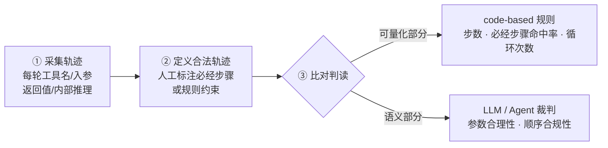

# 轨迹评估

## 实现流程

<b>图1 轨迹评估三步实现</b>

## 核心结论

- 轨迹评估关注 Agent 完成任务的**完整执行路径**，与只看终态的 [[结果评估]] 构成评估对象的两极。
- 它的独有价值是抓出**「结果正确但路径违规」**——调用越权接口、对同一查询反复重试、中间步骤泄露敏感数据，这些只看终态都会判为通过。
- 代价是**标注成本高**，且同一任务常有多条合法路径，需要解决轨迹对齐问题。

## 要点拆解

- **采集轨迹**：记录每轮工具名称、入参、返回值与内部推理，以及多轮状态与重试行为。
- **定义合法轨迹**：人工标注必经步骤，或直接由规则约束表达（如禁止调用写接口、重试不超过 3 次）。
- **比对判读**：可量化部分（步数、必经步骤命中率、循环次数）走 code-based 规则；语义部分（参数是否合理、顺序是否符合领域策略）交 LLM 或 Agent 裁判。
- **典型指标**：步骤数、循环检测、必经步骤命中率、工具与参数正确率。

## 适用边界

| 维度 | 说明 |
|---|---|
| 优势 | 可定位失败发生的具体环节，可发现「结果正确但路径违规」的隐患 |
| 劣势 | 标注成本高，多条合法路径的对齐问题难解 |
| 典型场景 | 多步工具调用、客服流程、生产监控 |

- 轨迹评估与 [[结果评估]] 的完整对照见 [[四类评估方法对比]] 与 [[Agent评估体系总览]]。
- 轨迹侧的规则化判读依赖确定性代码，语义判读依赖裁判模型，两者的分工与偏差问题见 [[LLM-as-a-Judge]]、[[独立验证机制]]。

## 相关页面

- [[结果评估]]：同层另一半，只看终态
- [[Agent评估体系总览]]：轨迹评估在五层结构中的位置
- [[Agent循环总览]]：被采集轨迹的运行时来源
- [[Agent循环终止与护栏]]：循环与重试行为对应的护栏机制
- [[Agent异常处理与循环检测]]：多 Agent 场景下的循环检测方案

## 参考来源

- [[raw/papers/Agent轨迹评估和结果评估.md]]
