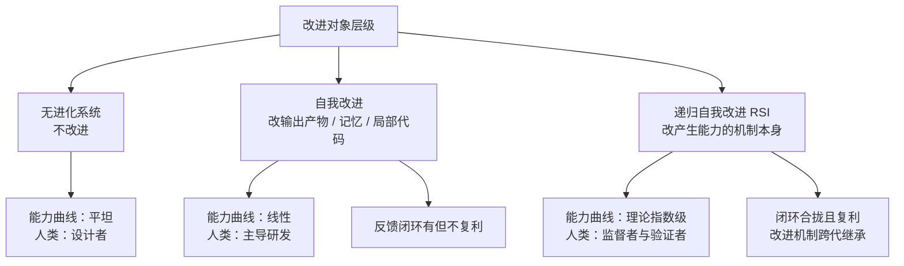

# 递归自我改进RSI

## 核心结论

RSI 的判据只有一条：**改的是不是「产生能力的机制本身」**。

用 Yampolskiy 的形式化说，若存在序列 $P_0, P_1, \ldots, P_n$ 使 $P_{i+1}=\text{Improve}(P_i)$ 且能力 $\text{Cap}(P_{i+1})>\text{Cap}(P_i)$ 恒成立，则系统具备 RSI 性质。「递归」的数学含义在于**改进机制进入改进对象集合**：

$$f_{n+1}=\Phi(f_n,f_n) \quad \text{而非} \quad f_{n+1}=\Phi(f_n)$$

多出的那个 $f_n$ 参数就是全部区别——它让改进者与被改进者是同一个东西，因而改进能力本身也能被改进。

## 要点拆解

### 三层递进结构的判定表

| 维度 | 无进化系统 | 自我改进 | 递归自我改进 |
|---|---|---|---|
| 改进对象 | 不改进 | 输出产物、记忆、局部代码 | 产生能力的机制本身 |
| 改进持久性 | 无 | 部分持久 | 持久且跨代继承 |
| 反馈闭环 | 无 | 有但不复利 | 闭环合拢且复利 |
| 能力曲线 | 平坦 | 线性 | 理论上指数级 |
| 人类角色 | 设计者 | 主导研发 | 监督者与验证者 |

**能力曲线那一行是最容易被误读的**：它标的是「理论上」指数级。现实中的 RSI 未必指数增长，是否真的点火要看 [[点火条件与复利因子G]]。

### 为什么必须区分「递归」与「自我改进」

当前 LLM 大多停在自我改进层：它们能改产物、改记忆、改局部代码，但**不改「自己是怎么被改进的」这套机制**。两者的工程差别极大：

- 自我改进：一轮改进的收益是**一次性**的，下次重新开始；
- 递归自我改进：一轮改进的收益**写回改进机制**，下一轮的起点更高。

这就是「复利」与「线性」的分水岭，展开见 [[有界RSI与开放式RSI]]。

### 与相邻概念的边界

| 概念 | 改进对象 | 与 RSI 的层级关系 |
|---|---|---|
| 自我对弈（Self-Play） | 策略与价值网络（封闭规则域） | RSI 的特例：闭环完整但改进不迁移域外 |
| AutoML / NAS | 人类定义搜索空间内的架构 | 无进化的自动搜索：在空间内寻优，不改空间 |
| Reflexion / Self-Refine | 单次任务的输出质量 | 自我改进层：未触及训练管线与下一代设计权 |
| 自我进化（Self-Evolution） | 数据、记忆、策略 | 层级低于 RSI：改进对象仍未落到改进机制 |

**边界判定的实操口诀**：问一句「它改完之后，下一代是否更擅长做改进这件事」。答是才是 RSI，答否就是自我改进或其变体。

### 四项判定标准

严格 RSI 须同时满足持久性、自主闭环、递归增益、稳健可控四项，逐条拆解见 [[RSI四项判定标准]]。缺第三条即为有界 RSI。

## 相关页面

- [[RSI四项判定标准]]：四项标准的逐条拆解与有界/开放式的分界。
- [[有界RSI与开放式RSI]]：复利是否成立带来的本质分层。
- [[点火条件与复利因子G]]：递归增益的量化判据 $G>1$。
- [[哥德尔机]]：RSI 的首个数学严格框架与理论上限。
- [[递归自我改进总览]]：本页所属的领域全景。
- [[Agent训练方法阶梯]]：Agent 能力来源的三级阶梯，其 L3 持续自我改进是 RSI 的工程前身。

## 参考来源

- 线上原文：[https://arxiv.org/abs/1502.06512](https://arxiv.org/abs/1502.06512)（Yampolskiy 2015，形式化判据）
- [[raw/papers/RSI递归自我改进.md]]（§1 核心定义与本质）
