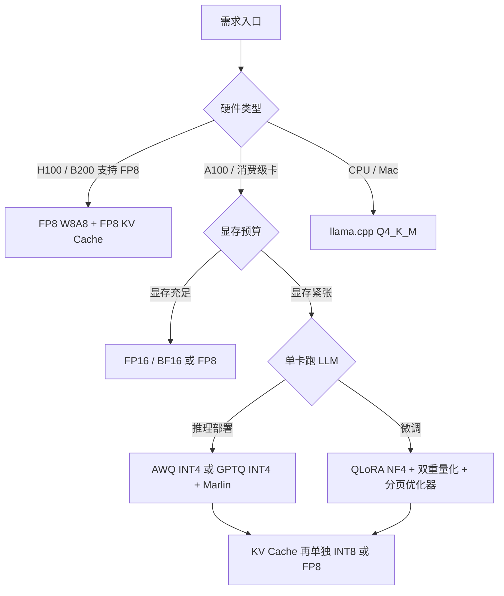

# 量化选型与避坑

## 核心结论

量化选型按「硬件—显存预算—精度要求」三步递进：硬件类型定第一分支（H100/B200 支持 FP8 走真低比特矩阵乘、A100/消费级卡走 weight-only、CPU/Mac 走 llama.cpp），显存预算定第二分支，精度要求定档位。工程上最大的坑是把权重量化等同于等比例加速，以及忽视校准集分布。

图 1 权重量化选型决策流程

## 要点拆解

### 八条避坑清单

- **校准集分布偏差**：PTQ 极度依赖校准数据，若校准用英文 Wiki 而线上是中文对话会导致精度显著退化，建议用 128~512 条与目标任务匹配的样本 [[10]](#ref-10)；
- **激活离群值**：某些 hidden dim 的数值极端激活使直接 W8A8 失效，必须先做 [[SmoothQuant]] 或换用 [[AWQ]] 这类 weight-only 方案绕开 [[1]](#ref-1) [[4]](#ref-4)；
- **小模型对小位宽更敏感**：1B 以下模型 INT4 损失明显大于 7B+，能上 Q5_K_M / Q6_K 就别强行压到 Q4 [[8]](#ref-8)；
- **混合精度算子保 FP**：LayerNorm、RoPE、Softmax、logits 输出通常保持 FP32/FP16，强行全量化会引入 NaN 或严重退化；
- **量化 ≠ 等比例加速**：W4A16 的矩阵乘在反量化后仍是 FP16 计算，加速主要来自带宽节省；要真用上低比特 Tensor Core 需 W8A8/FP8 或专门 Marlin kernel [[12]](#ref-12)；
- **KV Cache 协同**：长上下文不量化 KV 则显存反超权重，务必与权重选型协同 [[9]](#ref-9)；
- **GGUF 位宽按实测算**：Q4_K_M 平均位宽约 4.5~4.9 bit 而非严格 4-bit，估算显存按实测文件大小 [[8]](#ref-8)；
- **AWQ 与 GPTQ 选择**：AWQ 稳、GPTQ 上限略高，INT4 上差距通常很小，按生态兼容选 [[2]](#ref-2) [[3]](#ref-3)。

### 最小可运行示例（四步走）

生产路径通常四段：AutoGPTQ 离线量化并保存 → AWQ 一条命令量化 → llama.cpp 转 GGUF 并按档位量化 → vLLM 以 `quantization="awq_marlin"` + `kv_cache_dtype="fp8"` 加载服务。示例代码细节见 raw 素材第 9 节。

## 相关页面

- [[权重量化]]：选型避坑所属的上位概念，工程要点章节。
- [[KV Cache 量化]]：决策流程里 KV Cache 必做一步的细节。
- [[量化工具链与kernel]]：四步示例对应的工具链。
- [[主流量化算法对比]]：选型时对照的算法总表。

## 参考来源

[[raw/papers/权重量化.md]]
