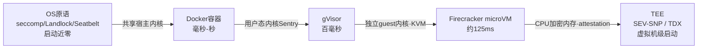

# 隔离技术谱系

## 核心结论

隔离强度的本质是**「共享了什么」**：

> 共享进程地址空间 < 共享内核（容器）< 共享虚拟化层（gVisor）< 独立内核（microVM）< 硬件加密内存（TEE）

**共享越少，隔离越强，代价越高。** 这条链既是强度排序，也是启动开销排序——两者总体反向，是选型的总约束。

## 要点拆解

### 三档主流载体

| 档位 | 代表 | 机制要点 | 展开页面 |
|---|---|---|---|
| 最轻 | OS 原语 | 不虚拟化不起容器，直接用内核特性约束进程及其子进程树 | [[OS原语沙箱机制]] |
| 中间 | gVisor | 用户态内核 Sentry 拦截并重新实现系统调用，暴露面大幅缩小 | [[gVisor用户态内核]] |
| 最强（同级） | microVM | 基于 KVM 每实例独立 guest 内核，逃逸需连破两层 | [[Firecracker微虚拟机]] |

容器（Docker）夹在 OS 原语与 gVisor 之间：共享宿主内核、Namespace + Cgroups 隔离、秒级启动几十 MB，是**内部可信任务与低风险工具执行**的主力，但共享内核决定了它的安全天花板，详见 [[容器逃逸与沙箱绕过]]。

### 其余四种形态

- **Kata Containers / Cloud Hypervisor**：OCI 兼容的轻量虚拟化路线，**形似容器，实为每 Pod 一个轻量 VM**；
- **Wasm 与 WASI**：能力安全模型——模块默认无任何权限，宿主显式授予目录与 socket 能力；线性内存天然隔离、微秒级启动、可嵌入宿主进程，与「每个 MCP 工具一个沙箱」的需求高度契合。与 [[MCP协议架构]] 的工具级隔离天然配套；
- **浏览器内沙箱**：WebContainers 把 Node.js 编译进浏览器，Pyodide 把 CPython 编译成 Wasm，**对宿主零接触**；
- **TEE**：AMD SEV-SNP 与 Intel TDX 用 CPU 加密内存，宿主 OS、hypervisor 与云运维均看不到 guest 明文，并提供硬件 attestation，把信任根推到硬件层。

### 权衡要点三条

1. **冷启动是 Agent 沙箱的头等指标**——Agent 要频繁、短时、大批量创建一次性执行环境，冷启动从边缘指标跃升为核心约束，应对方案见 [[沙箱冷启动加速技术]]；
2. **安全强度与启动开销总体反向**，应对手段是预热池、快照恢复与分支式沙箱，把有效冷启动压低一个数量级；
3. **本地与云端是两条路线，不是同一维度的高低**，详见 [[沙箱选型权衡与落地避坑]]。

## 相关页面

- [[沙箱隔离技术选型对比]]：本谱系的横截面——六类技术的机制、延迟、开销与场景对照表。
- [[容器逃逸与沙箱绕过]]：共享内核这一档的安全天花板实证。
- [[沙箱冷启动加速技术]]：与强度反向的冷启动如何被快照与预热池压下去。
- [[Agent沙箱技术全景总览]]：本页所属的领域全景。

## 参考来源

- [[raw/papers/Agent沙箱.md]]
