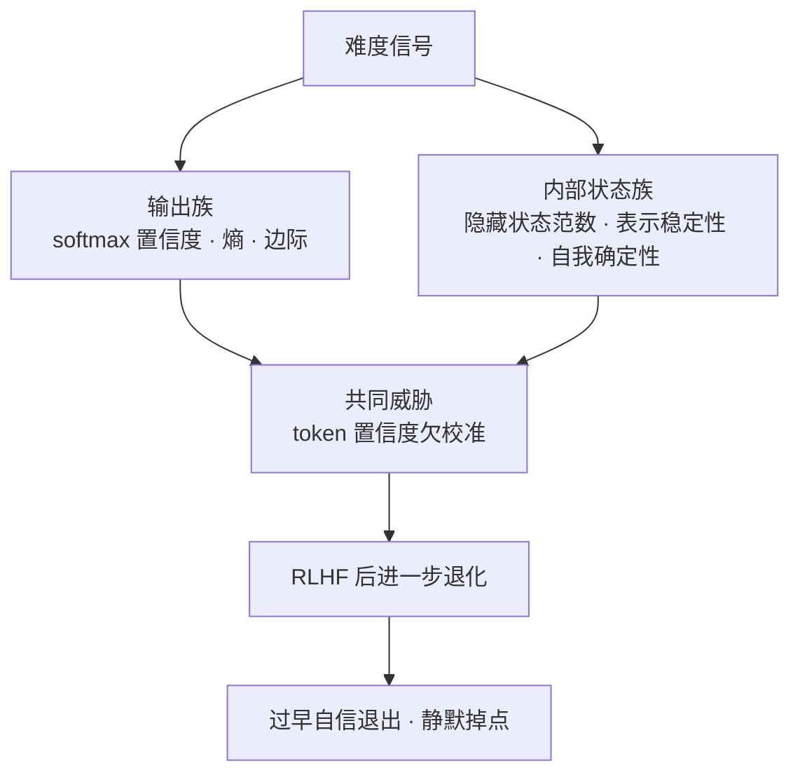

# 难度信号

## 核心结论

一切自适应决策的输入是难度信号，判断「难不难」的信号分两族：基于输出的有 softmax 置信度、熵与边际；基于内部状态的有隐藏状态范数、表示稳定性与自我确定性。两族信号都受同一个威胁：模型置信度并非天然可靠，自由生成场景的 token 置信度欠校准 [[11]](#ref-11)，RLHF 后校准进一步退化，未经校准的置信度会导致过早自信退出。

图 1 两族难度信号与共同的校准威胁

## 要点拆解

### 两族信号对照

| 族 | 信号 | 成本 | 语义 |
|---|---|---|---|
| 输出族 | softmax 置信度 / 熵 / 边际 | 低（前向输出免费拿） | 模型「觉得」有没有把握 |
| 内部状态族 | 隐藏状态范数 / 表示稳定性 / 自我确定性 | 低~中（探测向量，不动主输出库） | 模型「内部」稳不稳 |

### 校准是前置工程

Kadavath 的结论是条件性的：多选题与真假判断任务上模型大多校准良好（"mostly know what they know"），自由生成的 token 级置信度欠校准 [[11]](#ref-11)；基座校准良好但 RLHF 后明显退化，与 [[置信度校准与ECE]] 页结论一致。缓解手段见 [[语言化置信度]]：多次采样并语言化置信度可相对恢复约一半的校准损失。

### 停止策略对信号的要求

同一族信号喂养三档停止策略：静态阈值简单但难跨模型与数据集迁移；输入自适应阈值按样本难度动态调节退出门槛；在线学习策略用 Bandit 或强化学习在服务中持续调整退出决策。信号失准则整套策略飘移，先校准难度计再上自适应【推导】。

## 相关页面

- [[自适应推理]]：难度信号所属的上位概念，所有方法的共同输入。
- [[置信度校准与ECE]]：校准度量（ECE/Brier）与 RLHF 退化证据。
- [[语言化置信度]]：校准退化后的缓解手段。
- [[自适应失效模式]]：信号失准的失效后果。

## 参考来源

[[raw/papers/自适应推理.md]]
