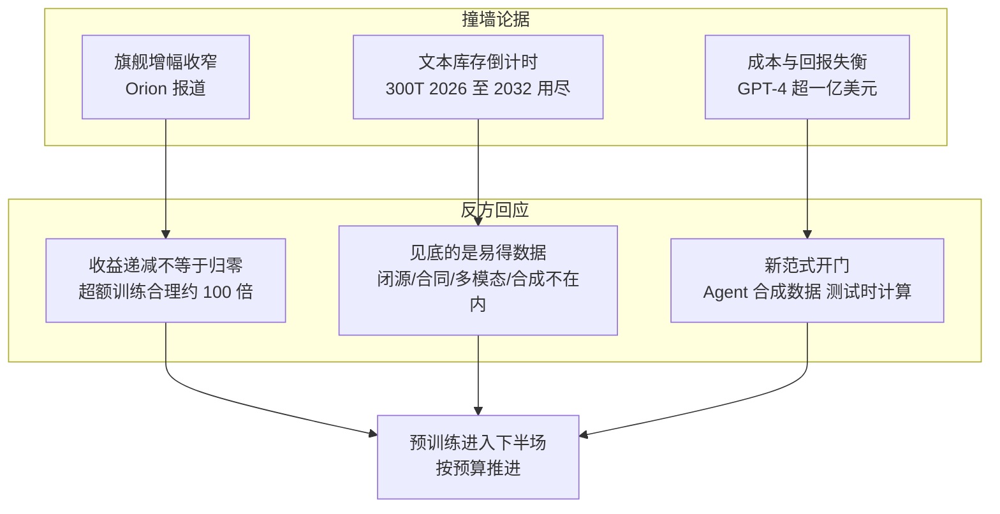

# 预训练撞墙与下半场

## 核心结论

2024 至 2025 年「Scaling 撞墙」从私下抱怨变成行业叙事，论据有三：旗舰增幅收窄 [[15]](#ref-15)、文本库存倒计时（约 300T，2026 至 2032 年间用尽，80% 置信区间）[[16]](#ref-16)、成本与回报失衡 [[17]](#ref-17)。反方回应同样有力：收益递减不等于归零，耗尽的是易得数据，新范式在开门 [[18]](#ref-18)。本质是预训练从「默认推进」变成「按预算推进」。

图 1 撞墙与反驳的论证结构

## 要点拆解

### 撞墙论据三条

- **旗舰增幅收窄**：The Information 报道内部代号 Orion 的下一代 GPT 增源不及预期（媒体报道，非论文）[[15]](#ref-15)；同期多家头部实验室旗舰迭代间隔变长、单次跃升变小，是可观测的行业现象；
- **数据侧倒计时**：Epoch AI 给出明确窗口——有效库存约 300 万亿 token（90% 置信区间 100T 至 1000T），若趋势延续，前沿模型将在 2026 至 2032 年间（80% 置信区间）用尽 [[16]](#ref-16)。该估算已修正过一次：2022 年原版预测高质量文本 2024 年前后用尽，随过滤技术进步被推迟。瓶颈是真的，只是位置在移动；
- **成本与回报失衡**：GPT-4 训练被证实「一亿美元以上」 [[17]](#ref-17)；Llama 405B 花了约 3090 万 H100 GPU 小时 [[7]](#ref-7)。每一次翻倍的价格变高、回报越买越少，财务模型会先于物理极限亮红灯。

### 情绪顶点：Ilya 宣言

2024 年 12 月 NeurIPS 获奖演讲，Ilya Sutskever：「Pre-training as we know it will unquestionably end」（我们已知的预训练，毫无悬念会终结）。理由冷峻而简单：「计算还在长，数据在停长，因为我们只有一个互联网。」 [[18]](#ref-18)

### 反方回应三条

- **收益递减不等于收益归零**：幂律数学性质决定不会「加钱换不到」，只会「加钱不划算」。Epoch 的利润模型显示，从收益角度合理的超额训练倍数可达约 100 倍，Llama 3-70B 即超额约 10 倍 [[16]](#ref-16)；
- **耗尽的是易得数据**：闭源私有数据、合同获取的领域数据、多模态数据都不在 300T 库存里；合成数据通道在扩张，前提是解决「合成是否带来新多样性」；
- **新范式在开门**：Sutskever 自己给出的出路就是路书——智能体、合成数据、测试时计算 [[18]](#ref-18)。

### 下半场判断（笔者判断，非论文结论）

**预训练 Scaling 进入下半场的本质，是这条曲线从「默认推进」变成「按预算推进」。** 活动中心从训练侧向推理侧转移（见 [[训练与推理时Scaling对比]]），但训练侧并未死亡——它在等新的数据供给结构（合成、合同获取、多模态）或新的表征效率（优化器 [[稳定性与Muon优化器]]、架构 [[MoE缩放律]]）把平衡点重新右移。把这条腿宣布死亡，多半会把下一段曲线提前写进历史，然后被它嘲笑。

## 相关页面

- [[数据受限扩展]]：重复与过滤如何给库存续命。
- [[训练前预测与算力配比]]：300T 库存的定量校验入口。
- [[训练与推理时Scaling对比]]：活动中心向推理侧转移的经济学。
- [[涌现能力与度量之争]]：「增幅收窄」可能是度量错觉的另一半。
- [[Kaplan与Chinchilla定律]]：超额训练倍数的路线背景。
- [[Scaling Law·素材摘要]]：本页所在素材全篇索引。

## 参考来源

[[raw/papers/Scaling Law.md]]
