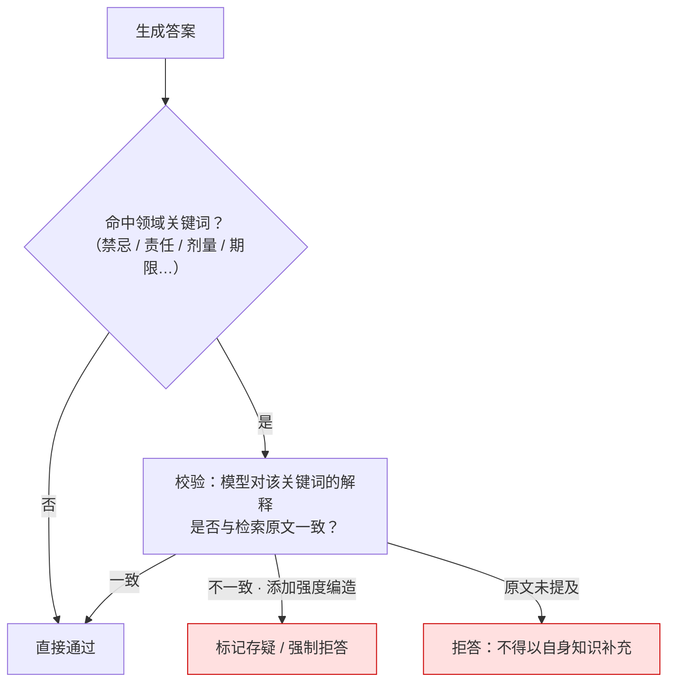

# 领域关键词校验

## 校验流程

## 核心结论

- **为什么需要它**：通用幻觉检测判断的是"这句话有没有出处"，但高风险场景真正致命的是**关键信息被流畅地编造**——药品禁忌被编掉、合同责任被改写、剂量被说错。这类错误在通顺度上毫无破绽，只有用**领域词库锚定关键位点**才能抓住。
- **它是领域知识对通用检测的补充**：[[幻觉检测三条路径]] 判断"整体是否忠实"，领域关键词校验判断"**关键位点**是否忠实"，两者粒度不同、互不替代。
- **原文未提及时必须拒答**：高风险领域不允许"模型自己知道就算对"，这是与通用 RAG 最大的口径差异。

## 要点拆解

### 词库构建

| 步骤 | 做法 |
|---|---|
| 1. 圈定关键位点 | 从业务风险清单出发：药品禁忌、剂量上限、责任条款、有效期、金额上限 |
| 2. 构建词库 | 每个位点维护关键词/同义词/正则（如 `禁忌`、`不得`、`最高.*天`） |
| 3. 绑定判定规则 | 命中某关键词时，必须能在召回原文中定位到对应表述 |
| 4. 灰度上线 | 先只标记不拦截，统计误报率后再决定是否强制拒答 |

### 三档处理

| 情形 | 处理 |
|---|---|
| 解释与原文一致 | 放行 |
| 解释与原文不一致 | 标记存疑 / 强制拒答 |
| 原文未提及该关键词 | **拒答**（不允许模型自身知识补位） |

第三档是本机制与普通校验的关键差异：普通场景可以说"根据常识"，高风险场景必须说"资料未提及"。

### 词库维护成本（诚实说明）

领域词库需要随法规/业务规则更新而维护，属于**持续性成本**；词库过窄会漏检、过宽会误报。因此建议先从高风险动作（开方、下单、签约、付款）起步，而非一开始追求全词库覆盖。

本素材未给出词库规模、误报率等可量化数据，工程落地时需自行标定。

## 相关页面

- [[RAG准确率保障体系]]：本页所属的防护层
- [[幻觉检测三条路径]]：通用检测路径，与本页的领域粒度互补
- [[生成侧结构化约束]]：答案结构化后才便于按位点校验
- [[RAG阈值拒答机制]]：原文未提及时的拒答属于阈值拒答的场景化特例
- [[输出验证与人工审批]]：高风险场景的人工终审
- [[RAG界面溯源设计]]：把核验权交给用户

## 参考来源

- [[raw/papers/RAG准确率提升.md]]