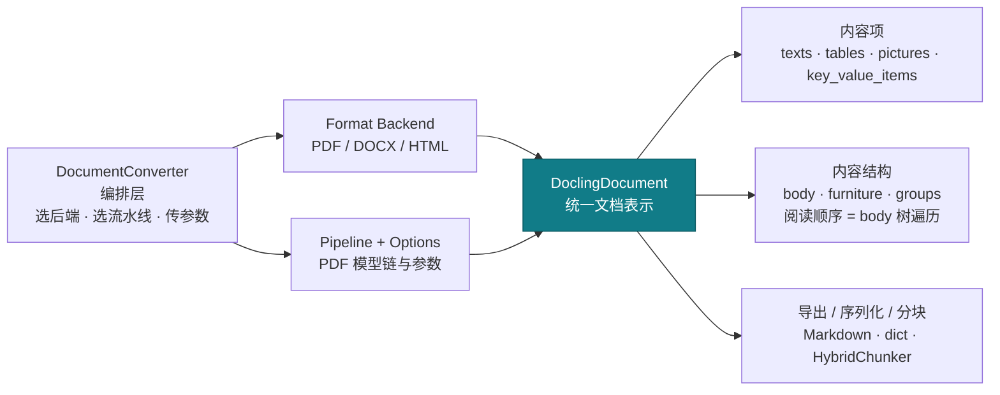

# Docling

## 简介

Docling 是 IBM Research 开源的**文档转换框架**。与 MinerU 的"自研高精度解析模型"路线不同，Docling 不做单一解析模型，而做可编排的文档转换框架——以统一文档表示为中枢，后端、流水线与选项解耦。定位是追求可编排、可扩展的文档底座，尤其面向 RAG 分块与多格式支持。

- 出身上下文：[[文档智能工程落地]] 中两条工程路线之一（另一条为 [[MinerU]]）
- 上游概念：[[文档智能]]、[[文档VLM三大范式]]

## 三层架构

- **DocumentConverter**：编排层，为每种格式维护一个转换器，决定用哪个后端解析、哪个流水线执行、传哪些选项。
- **Format Backend**：PDF / DOCX / HTML 等输入格式的解析后端。
- **Pipeline**：PDF 模型链与参数。

## DoclingDocument：统一文档模型

**DoclingDocument** 是核心价值：一个 pydantic 类型，统一表达文本/表格/图片、章节与分组层级、正文与页眉页脚之分、所有项的 bbox 与来源。

数据结构分两类：

| 类别 | 字段 | 内容 |
|---|---|---|
| 内容项 | `texts` / `tables` / `pictures` / `key_value_items` | 段落、标题、公式（基类 TextItem）等具体数据 |
| 内容结构 | `body` / `furniture` / `groups` | 正文树根 / 页眉页脚等非正文 / 列表与章节容器 |

各项以 JSON 指针互引，阅读顺序由 `body` 树遍历决定。这正呼应 [[文档智能]] 四段能力链中的"解析"段——二维版面被编码进显式、可查询的文档对象模型。

## 流水线组件与 RAG 特性

- **离线预取模型**：版面、TableFormer、图片分类、代码与公式、EasyOCR 五类，均可插拔——OCR 可换 RapidOCR/Tesseract，TableFormer 分 FAST/ACCURATE 两档，可强制整页 OCR 或接远程 VLM（见 [[表格结构还原]] 的 TableFormer）。
- **RAG 分块**：由 `HybridChunker` 承担，每个 chunk 自带 `headings` 层级路径与 `prov` 坐标，可直接入库——这是 Docling 面向 [[文档智能工程落地]] 中 RAG 场景的核心价值。

## 隐私设计

默认**全本地、不共享数据**；用远程服务须显式设 `enable_remote_services=True`，否则抛 `OperationNotAllowed()`。"默认不联网"使私有部署天然合规，呼应 [[文档智能校验三支柱]] / 私有部署的合规驱动力。

## 相关

- 对比：[[MinerU与Docling对比]]；另一条轻量路线见 [[MarkItDown]]
- 出身上下文：[[文档智能工程落地]]