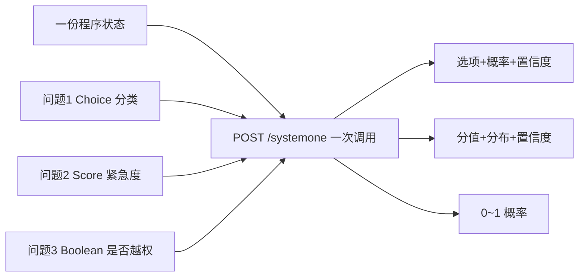

# Jev 决策模型

## 定义

Jev 是 TypeSafe AI 于 **2026-09-15** 发布的**第一个 System One 模型**，是「系统一模型」这个新品类在工业界的首次落地，由创始人 Diogo Almeida（ChatGPT 研发参与者、RLHF 提出者之一）、Erik Gafni、Sasha Sheng 创办的公司发布，同期亮出 DCVC 领投的 4000 万美元种子轮。

## 一句话区分

**LLM 的产物是「给人看的文本」，Jev 的产物是「给程序用的判断」**。典型例子：客服消息「接口返回 500 错误」，传统做法让 LLM 输出 JSON 再解析，Jev 直接把消息作为状态、附上预定义问题，返回结构化选项/分数/概率，代码立刻读取字段。

## 核心属性（四点）

1. **类型化输出**：答案约束在预定义类型内，不写自由文本，官方称类型层面「不会产生幻觉」。见 [[类型化输出]]。
2. **并行采样**：所有答案一次前向计算并行产生，非逐 token 自回归。见 [[并行采样机制]]。
3. **校准置信度**：每个决策带概率，软件据此自动执行或转人工。见 [[校准置信度]]。
4. **面向机器的接口**：官方称「更像代码」——可靠、快速、自洽、类型安全。

## 三种决策原语

通过同一接口混用：**Choice**（选一个）、**Score**（打分）、**Boolean/Noul**（陈述是否成立）。详见 [[决策原语]]。

## 性能与成本

- **延迟**：端到端 70~500 毫秒（厂商报告）。
- **定价**：输入 $0.042/百万 token，输出免费（响应仅几个字节结构化数据）。
- **提速降本**：厂商自称 193.6x 快、444.6x 便宜；独立实测约 25x、580x。见 [[Jev 与传统 LLM 对比]]。

## 适用场景与落地

- Agent 决策节点：工具选型、任务完成判据、风险拦截、结果验证。
- 客服分流、检索重排、引用支持、提示注入检测、内容审核、批量标注。
- 甜蜜点：答案有边界 + 判断量很大。详见 [[Jev 应用与落地]]。

## 局限

不擅长开放生成（不能写/总结/规划，算术不可靠），隐藏推理需拆分或交推理模型，权重未开放（早期接入、仅文本输入）、独立校准数据稀少。

## 相关导航

- 总览：[[Jev 决策模型总览]]
- 公司：[[TypeSafe AI]]
- 品类：[[System One 模型]]
- 对比：[[Jev 与传统 LLM 对比]]
- 落地：[[Jev 应用与落地]]
- 素材摘要：[[Jev决策模型·素材摘要]]

