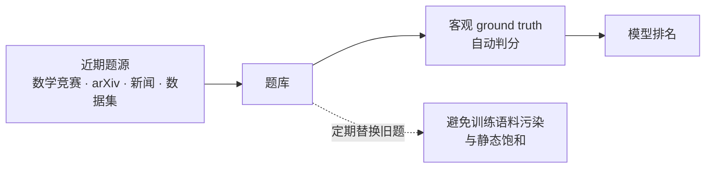

# LiveBench

## 抗污染设计

<b>图1 LiveBench 的抗污染判分链路</b>

## 核心结论

- LiveBench 是**抗污染、动态更新**的 LLM 基准，设计目标是同时解决静态基准的两大失效：**测试集污染**（题目进入训练语料）与**难度饱和**（头部模型分数趋同、区分度归零），见[[基准污染与动态基准]]。
- 两条设计选择：题源取自**近期**数学竞赛、arXiv 论文、新闻与数据集，且题目按**客观 ground truth 自动打分**——所以它既不需要 LLM 评委、也不用人工众包，从而顺带规避了评委偏差与人工评测的规模瓶颈。

## 要点拆解

- **题型覆盖**：六类共 **18 个任务**，含数学、推理、编码、数据分析、指令遵循与语言能力等方向，兼顾客观题与开放题。
- **难度水位**：头部模型准确率**低于 70%**（ICLR 2025 版口径），说明在同期静态基准纷纷饱和时仍保有较大提升空间。
- **动态机制**：题库定期用新题替换旧题，降低新模型「背过题库」的可能；代价是题源更新依赖人工或程序持续投入，成本高于静态基准。
- **在评测体系中的位置**：属[[可验证性四通道]]中的**程序化 ground truth** 通道（答案对错可独立复核），并被[[大模型评测可信体系总览]]列为基准可信支线的代表方案。
- **与同类基准的取向差异**：Chatbot Arena 以人类偏好投票为主、HELM 强调多维可复现的透明度量，LiveBench 则以客观判分与抗污染为核心取向，三者不可互替。

## 相关页面

- [[基准污染与动态基准]]：污染风险与检测/防御两张清单
- [[TS-Guessing污染检测]]：检测侧的黑盒手段
- [[可验证性四通道]]：程序化 ground truth 通道
- [[大模型评测可信体系总览]]：四支柱总览与代表方案表
- [[大模型评测可信·素材摘要]]：素材出处

## 参考来源

- [[raw/papers/大模型评测可信.md]]
- [LiveBench: A Challenging, Contamination-Limited LLM Benchmark](https://arxiv.org/abs/2406.19314)，arXiv:2406.19314
