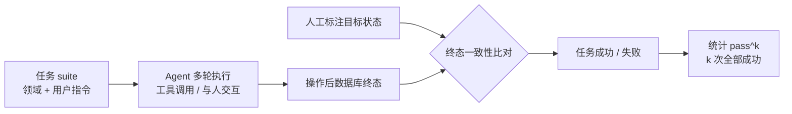

# τ-bench

## 评测流程

<b>图1 τ-bench 的终态比对与 pass^k 统计</b>

## 核心结论

- τ-bench 是**工具-智能体-用户交互**基准，专为填补既有基准「既不测试智能体与用户交互、也不测试其遵循领域规则」的空白而设计。
- 它的判定方式是**结果评估里的终态比对式**——不看 Agent 说了什么，只看工具操作后数据库状态是否与人工标注目标一致，详见 [[结果评估]]。
- 它是 **pass^k 指标的提出者**，把「一致性」正式纳入基准口径，见 [[pass@k与pass^k]]。

## 实测水位

- gpt-4o 级别函数调用智能体在 **retail 域任务成功率不足 50%、pass^8 低于 25%**。
- 该结果揭示了主流 Agent 的一致性缺陷：单次能做对，连续八次全对却不到四分之一，推动业界投入一致性与规则遵循能力。

## 要点拆解

- **领域设定**：以零售（retail）、航空（airline）等真实的业务域为背景，把「遵循领域规则」写进评测目标。
- **交互形态**：Agent 需与模拟用户多轮交互并调用业务工具，考察的是完整闭环而非单轮问答。
- **终态比对**：成败由数据库终态是否等于目标状态判定，属于可枚举验证、可大规模自动化的评估。
- **演进**：tau2-bench 已扩展支持语音全双工等多模态交互评测，评估面从文本工具调用走向多模态交互。

## 相关页面

- [[结果评估]]：τ-bench 所属的评估对象形态
- [[pass@k与pass^k]]：由其提出的可靠性指标
- [[Agent评估组合策略]]：τ-bench 被安排在基准对比阶段
- [[Agent轨迹评估与结果评估·素材摘要]]：本页编译所依据的素材摘要

## 参考来源

- [[raw/papers/Agent轨迹评估和结果评估.md]]
- [τ-bench: A Benchmark for Tool-Agent-User Interaction in Real-World Domains](https://arxiv.org/abs/2406.12045)，arXiv:2406.12045
- [sierra-research/tau2-bench](https://github.com/sierra-research/tau2-bench)
