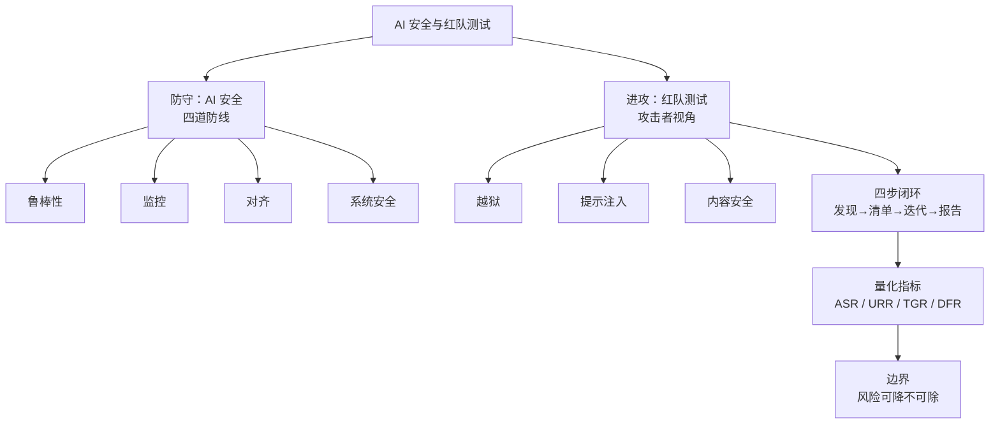

# AI安全与红队测试总览

## 架构总览

<b>图1 AI 安全与红队测试整体框架</b>

## 核心结论

- **传统平均指标评测盖不住部署中的长尾与对抗性失效**，这是 AI 安全与红队测试共同的问题起点[[AI安全与红队测试·素材摘要]]。
- **防守侧**：AI 安全以[[机器学习安全四大类别]]（鲁棒性/监控/对齐/系统安全）构建技术纵深，逻辑分工依次回答「想不想做坏事—能不能被诱导—做了能否被发现—生态会不会被拖垮」。
- **进攻侧**：[[红队测试四步闭环]]（发现—清单—迭代—报告）持续冲击[[三大威胁向量]]（越狱/提示注入/内容安全），把模型缺陷暴露在部署之前。
- **量化**：用[[红队量化指标ASR与URR]]把风险变成可比、可回归的数字，才可能成为发布与部署的硬性门禁。
- **边界**：见[[红队测试边界与军备竞赛]]——风险可降不可除，**通过红队不等于绝对安全**。

## 要点拆解

| 维度 | 要点 | 对应页面 / 文献 |
|---|---|---|
| 问题起点 | 平均指标掩盖重尾风险、评测环境与部署环境脱节、能力提升不自动带来安全 | [[大模型评测可信体系总览]]、Ganguli 等规模实验 |
| 防守框架 | 鲁棒性 / 监控 / 对齐 / 系统安全四类嵌套 | [[机器学习安全四大类别]]、Hendrycks 等 |
| 威胁向量 | 越狱、提示注入、内容安全 | [[三大威胁向量]]、OWASP LLM Top 10 |
| 红队流程 | 发现 → 清单 → 迭代 → 报告（回归闭环） | [[红队测试四步闭环]] |
| 自动化攻击 | GCG 可迁移对抗后缀、红队语言模型、PyRIT 流水线 | [[GCG对抗攻击]]、[[PyRIT]] |
| 量化与基准 | HarmBench 统一攻击分类、目标行为分类学与指标定义 | [[HarmBench]]、[[红队量化指标ASR与URR]] |
| 防御验证 | Constitutional Classifiers 部署前 3000+ 小时红队 | [[Constitutional Classifiers]] |
| 实现方式 | 人工 / 红队语言模型 / 梯度优化 / 混合人机协作 | [[红队实现方式对比]] |

- 两条主线的交汇点即红队测试：安全研究框架化（Hendrycks）与对抗视角引入评测（Perez、Ganguli）在此合流，红队从可选环节变成连接安全研究与生产部署的桥梁。
- 该框架的上位定位：它是 AI/模型级安全的整体视图，[[LLM-Agent安全防护总览]]是其「提示注入」威胁在 Agent 场景下的纵深展开。

## 相关页面

- [[AI安全与红队测试·素材摘要]]：本总览的原始素材要点索引
- [[AI安全定义与边界]]：AI Safety 的定义、事故/滥用/有害后果三分类与 Safety/Security 之分
- [[机器学习安全四大类别]]：鲁棒性/监控/对齐/系统安全四道防线
- [[三大威胁向量]]、[[越狱攻击]]：攻击面分类与越狱机理
- [[红队测试四步闭环]]、[[红队量化指标ASR与URR]]、[[红队实现方式对比]]：红队的流程、指标与实现选型
- [[GCG对抗攻击]]、[[HarmBench]]、[[PyRIT]]、[[Constitutional Classifiers]]：代表攻击与防御方案
- [[红队测试边界与军备竞赛]]：红队结论的固有边界
- [[LLM-Agent安全防护总览]]：Agent 侧提示注入纵深防御体系，与本页「提示注入」威胁互补
- [[大模型评测可信体系总览]]：评测可信度四支柱，与本文的「量化指标可信」同源
- [[Prompt注入与防范·素材摘要]]、[[提示词注入]]：注入威胁的既有沉淀

## 参考来源

- [[raw/papers/AI安全与红队测试.md]]
