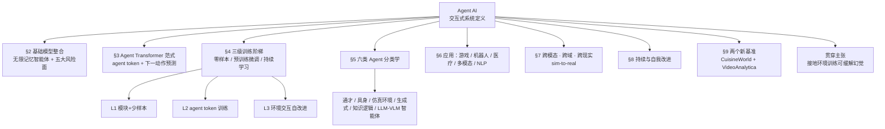

# Agent AI综述总览

## 核心结论

这篇综述的骨架是**一条定义 + 一条范式 + 一条训练路径 + 一整套分类与基准**。它真正的主张只有一个：**把智能体放进接地环境里训练，可以同时获得动作能力与幻觉抑制**。

读它要分清两层：**定义层与分类层是长期有效的**（具身 Agent、动作型/交互型二分、六类分类学）；**能力实测层已明显过时**（2023 年的 GPT-4V 定性实验）。

论文身份需先校正：14 位作者，第一作者 Zane Durante，项目负责人 Qiuyuan Huang 与 Jianfeng Gao（微软研究院），Li Fei-Fei 以 Stanford 身份参与；机构为 Microsoft Research/Microsoft Gaming + Stanford + UCLA + UW。**不是「李飞飞的综述」，而是产学联合综述**。2024-01-07 提交、2024-01-25 修订 v2，此后无新版本，至今为预印本。

## 要点拆解

### 定义与主张

Agent AI 被定义为「能感知视觉刺激、语言输入和其他环境接地数据，并能产出有意义的具身动作的交互式系统」；训练目标是**下一具身动作预测**。核心论点是从这一设定的直接推论：接地环境里的动作会被真实状态证伪，因此**能缓解基础模型把内部知识当世界状态、生成与环境不符输出的倾向**。

定义的展开见 [[具身Agent与环境接地]]，主张的机制见 [[环境接地式幻觉治理]]。

### 范式：Agent Transformer

在视觉 token 与语言 token 之外为动作预留第三类 **agent token**，把视觉、语言与动作统一进一个 Transformer 的输入输出接口。对照方案是「冻结 LLM + 冻结视觉编码器 + 适配层」（Flamingo/BLIP-2/LLaVA 路线）。四项优势：可定制到语言难以表述的动作、可解释性（读 agent token 概率）、强隐私域可私有化、相对小而便宜。

详见 [[AgentToken与下一动作预测]]。

### 三级训练阶梯

| 级别 | 形态 | 关键手段 | 主要局限 |
|---|---|---|---|
| L1 零样本/少样本 | Agent 模块 + 基础设施 | MindAgent 五模块、in-context learning | 能力被预训练模型锁死 |
| L2 预训练/微调 | Agentic Foundation Model | RL / IL（行为克隆）、agent token 训练 | 数据与算力门槛高 |
| L3 持续学习 | 环境交互中自我改进 | 人类交互数据、模型自生成数据 | **当前普遍缺失，属开放问题** |

L2 里论文有一个明确取舍：**用无限记忆智能体做模仿学习，并以 in-context prompt 或隐式奖励刻画专家行为，而非直接复制专家策略**——理由是纯模仿在未见情境泛化差。详见 [[Agent训练方法阶梯]]。

### 六类 Agent 分类学

| 类别 | 代表子类 | 判据 |
|---|---|---|
| 通才智能体 | — | 跨任务跨模态泛化 |
| 具身智能体 | 动作型（游戏/机器人）、交互型 | 是否需物理动作 |
| 仿真与环境智能体 | Habitat、VirtualHome、Overcooked-AI | 以仿真替代真实试错 |
| 生成式智能体 | AR/VR/MR | 生成场景与内容 |
| 知识与逻辑推理智能体 | 知识/逻辑/情感推理/神经符号 | 推理形态 |
| LLM/VLM 智能体 | — | 以基础模型为内核 |

分类学不是装饰：**它回答「你的 Agent 属于哪一类」，从而决定查哪一类的问题清单**。

### 应用与两个新基准

应用层覆盖游戏（NPC 行为、人机交互、场景合成）、机器人（视觉运动控制、语言条件操作、技能优化）、医疗（诊断智能体、知识检索智能体、远程监护）、多模态与 NLP 智能体。

两个自建基准是长期可用的部分：

- **CuisineWorld**：文本协作游戏，集中调度/去中心双模式，配 **CoS 协作效率指标**，见 [[协作效率指标CoS]]；
- **VideoAnalytica**：分析型视频演示理解基准，两任务（视频文本检索、视频辅助信息型问答），难负例由 LLM 生成后再人工清洗。

### 五大风险面

综述第 2 章把基础模型风险归为五类：**幻觉、偏见与包容性、数据隐私与使用、可解释性、监管**。其中可解释性一条给了三段式链条——模仿学习→解耦（把学奖励与学策略分开）→泛化→涌现行为。这是它少数有机制价值的部分，但深度有限，本库未单独建页。

### 该读哪几章

| 目的 | 章节 |
|---|---|
| 补概念定义 | §1.3、§5.1-§5.4 |
| 补动作建模与训练 | §3、§4 |
| 找多智能体评估思路 | §9.1 |
| 找案例与实验 | §6（**注意时效**，2023 年 GPT-4V 定性结果） |
| 可跳过 | §2.2.2 偏见、§2.2.3 隐私合规清单、§10-12 伦理声明、附录 A-F 游戏实测 |

## 相关页面

- [[具身Agent与环境接地]]：定义层与四层谱系。
- [[AgentToken与下一动作预测]]：范式的技术内核。
- [[环境接地式幻觉治理]]：贯穿主张的机制。
- [[Agent训练方法阶梯]]：能力从哪来的三级路径。
- [[协作效率指标CoS]]：多智能体协作质量的量化。
- [[Agent循环]]：软件运行时视角的 Agent 定义，与本页构成两层对照。
- [[Agent评估体系总览]]：CoS 与 VideoAnalytica 在评估体系中的位置。
- [[多Agent上下文管理总览]]：多智能体系统的另一条主线。

## 参考来源

- 线上原文：[https://arxiv.org/abs/2401.03568](https://arxiv.org/abs/2401.03568)（arXiv:2401.03568v2，80 页，2024-01-25）
- 本地备份：[[raw/papers/Agent-AI-Surveying-the-Horizons-of-Multimodal-Interaction.pdf]]
- [[Agent-AI综述·素材摘要]]：本页对应的素材要点索引
