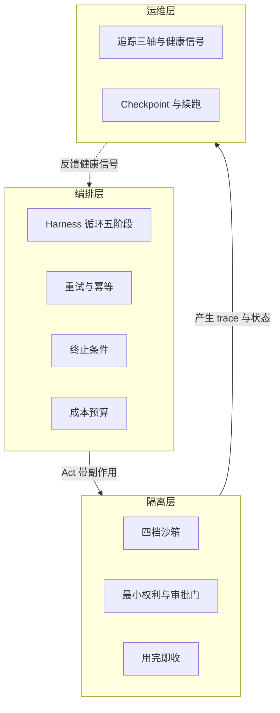

# Agent工程化三层架构总览

## 核心结论

- Agent 工程化的核心障碍**不是模型能力**，而是缺乏围绕**非确定性模型的外部可靠性约束体系**。
- 三层正交切分同一执行栈：**编排层管『怎么循环推进』、隔离层管『能碰什么』、运维层管『看得见且跑得久』**。
- 实证：同一模型在不同 Harness 配置下表现差异显著，三层协同是 Agent 生产化的关键。

## 三层架构协同关系

图1 Agent 工程化三层架构协同关系

> 三层并非串行流水线，而是同一执行栈上的**正交切面**：编排层每轮循环调用隔离层的沙箱与审批门，运维层持续采集两层产生的 span、状态与审计记录。

## 三层职责速览

| 层 | 回答的问题 | 核心模块 | 关键手段 |
|----|-----------|---------|---------|
| 编排层 | 如何推进 | Harness 循环、幂等、终止、预算 | [[Harness循环五阶段]]、[[Agent幂等四层防御]]、[[Agent终止条件多路熔断]]、[[Agent成本四维预算]] |
| 隔离层 | 能碰什么 | 四档沙箱、最小权利、审批门 | [[四档沙箱隔离模型]]、[[Agent最小权利与审批门]] |
| 运维层 | 看得见跑得久 | 追踪三轴、Checkpoint、Durable | [[Agent可观测追踪三轴]]、[[Checkpoint与DurableExecution差异]] |

## 适用边界

- 价值密度随任务**危险性与长时性**递增：简单、短周期、单轮交互任务可用轻量 Harness；
- 涉及外部副作用、不可逆操作、多日审批或需审计合规的生产级 Agent，三层不可或缺。
- 三层架构非零成本：复杂度交付（跨三团队协同）、延迟开销（权限判定/审批路由/span 采集）、测量成本（instrumentation 是持续工程）。

## 相关页面

- [[Agent生产化四类痛点]]：为什么需要三层约束
- [[Harness循环五阶段]]：编排层核心
- [[四档沙箱隔离模型]]：隔离层纵深防御
- [[Agent可观测追踪三轴]]：运维层可观测
- [[Agentic Harness]]：既有 Harness 运行时视角
- [[Agent循环终止与护栏]]：终止协议的既有体系

## 参考来源

- [[raw/papers/Agent工程化三层架构.md]]