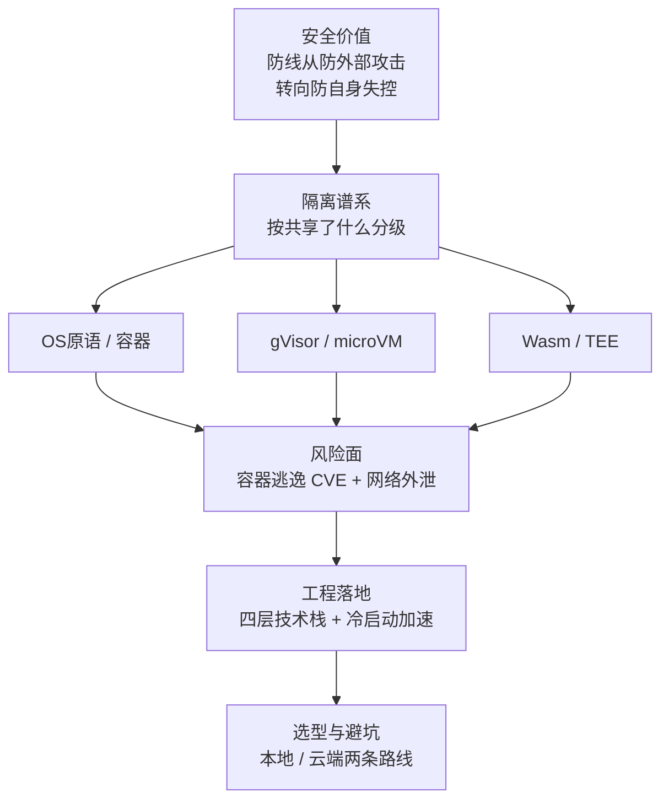

# Agent沙箱技术全景总览

## 核心结论

Agent 沙箱不是容器，也不是虚拟机，而是**隔离、权限策略、生命周期管理与审计组合而成的执行底座**。它的防护重心与传统安全沙箱不同：传统沙箱抵御**外部恶意代码主动逃逸**，Agent 沙箱约束**智能体自主行动的越界风险**，目标是可控、可回滚、可审计。

判断一项隔离技术强弱，只需问一个问题：**共享了什么**。共享进程地址空间 < 共享内核 < 共享虚拟化层 < 独立内核 < 硬件加密内存——**共享越少，隔离越强，代价越高**，这条权衡链贯穿全篇。

## 十节主线

| 段 | 问题 | 落点页面 |
|---|---|---|
| 为什么 | Agent 为什么必须被关进沙箱 | [[Agent沙箱定义与安全价值]] |
| 是什么 | 隔离强度靠什么分级 | [[隔离技术谱系]] |
| 分层展开 | 三类主流载体各自怎么工作 | [[OS原语沙箱机制]]、[[gVisor用户态内核]]、[[Firecracker微虚拟机]] |
| 风险 | 容器逃逸史与 Agent 特有绕过 | [[容器逃逸与沙箱绕过]] |
| 横评 | 同行怎么选 | [[沙箱隔离技术选型对比]]、[[Agent沙箱平台横评]] |
| 怎么落地 | 企业级底座怎么分层 | [[沙箱四层技术栈]] |
| 怎么变快 | 冷启动怎么压到几十毫秒 | [[沙箱冷启动加速技术]] |
| 怎么避坑 | 哪些常识是错的 | [[沙箱选型权衡与落地避坑]] |

## 三条可直接用的结论

1. **「任意不可信代码 + 多租户」场景下，容器已知不充分**——这是共享内核这条天花板决定的，也是以容器换冷启动的平台仍提供 gVisor 加固选项的原因，详见 [[容器逃逸与沙箱绕过]]。
2. **数据外泄几乎都走网络**，出口控制与内核隔离同等重要；只做计算隔离不做出口白名单，等于留了一条免费信道，详见 [[容器逃逸与沙箱绕过]]。
3. **本地与云端是两条路线，不是同一维度的高低**：本地 Coding Agent 用 OS 原语加代理与审批（开销近零但共享个人机器），云端沙箱即服务用 microVM 或 gVisor（隔离强、可并行扩展但有往返延迟与成本），详见 [[沙箱选型权衡与落地避坑]]。

## 一条收敛信号

跨公司独立收敛到几乎相同的架构——**OS 原语 + 网络代理 + 沙箱与审批解耦**——本身就是路线正确的信号，各家细节见 [[Agent沙箱平台横评]]。

## 未来三个方向

1. **动态权限自适应**：按 Agent 行为模式动态收紧或放宽隔离等级；
2. **TEE 硬件级隔离**：AMD SEV-SNP 与 Intel TDX 与 microVM 路线互补而非替代，见 [[隔离技术谱系]]；
3. **接口标准化**：业界对统一沙箱调用接口尚无定论，可参考 OASIS 一类开放标准范式推进跨厂商迁移。

## 相关页面

- [[LLM-Agent安全防护总览]]：沙箱是执行层的架构隔离手段，与提示词注入防御同属纵深防御体系。
- [[LLM权限最小化]]：沙箱把「权限给得越多越危险」落到运行时硬边界上。
- [[Agent生产落地实践]]：确定性边界原则在执行环境上的具体实现。
- [[Agent沙箱·素材摘要]]：本总览所依据的 raw 素材要点摘录。

## 参考来源

- [[raw/papers/Agent沙箱.md]]
