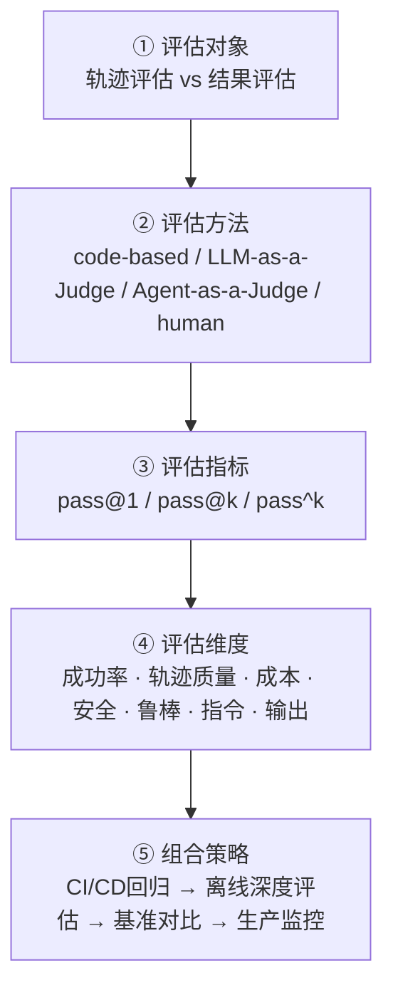

# Agent评估体系总览

## 架构总览

<b>图1 Agent 评估五层结构</b>

## 核心结论

- **单轮文本评测不足以刻画 Agent 能力**，三类瓶颈：评估对象错位（只看结果漏掉违规过程）、评估手段两难（人工不可扩展、LLM 裁判被动）、指标误导（只看 pass@k 高估可靠性）[[Agent轨迹评估与结果评估·素材摘要]]。
- 评估对象的辨析基准是「评过程还是评终态」，即 [[轨迹评估]] 与 [[结果评估]]；方法层面本质区别在于「由谁判断、依据什么判断」。
- **生产级评估的三件套**：结果评估做门槛、轨迹评估做诊断、pass^k 做可靠性标尺，再按研发生命周期组合四类方法（详见 [[Agent评估组合策略]]）。
- 指标是体系里最易踩坑的一环：pass@k 与 pass^k 符号相近、语义相反，见 [[pass@k与pass^k]]。

## 要点拆解

| 层 | 回答的问题 | 主要落点页面 |
|---|---|---|
| 评估对象 | 评什么 | [[轨迹评估]]、[[结果评估]] |
| 评估方法 | 用什么评 | [[LLM-as-a-Judge]]、[[Agent-as-a-Judge]]、[[人工评估与裁判校准]]、[[四类评估方法对比]] |
| 评估指标 | 怎么量化 | [[pass@k与pass^k]] |
| 评估维度 | 覆盖哪些面 | [[Agent评估组合策略]]、[[意图评测]] |
| 组合策略 | 怎么落地 | [[Agent评估组合策略]]、[[持续评估]] |

- **轨迹评估**关注完整执行路径（工具调用序列、参数、中间推理、多轮状态、重试行为），可发现「结果正确但路径违规」的隐患，代价是标注成本高、多条合法路径难对齐。
- **结果评估**只看最终输出或终态是否达标（答案正确性、数据库终态一致性、测试通过），实现简单可自动化，但对「蒙对」与「违规但结果正确」完全失明。
- **指标**层面，pass@k 衡量能力上限（k 次中至少一次成功），pass^k 衡量生产可靠性（k 次全部成功）；真实用户不会无限重试，故对会改变真实世界状态的 Agent，pass^k 更诚实。
- **维度**层面至少覆盖任务成功率、轨迹质量、效率与成本、安全与合规、鲁棒性、指令遵循、输出质量七项，不同维度适配不同方法。

## 当前局限与演进

- code-based 只覆盖可枚举验证的域，对开放任务无能为力；LLM-as-a-Judge 的位置与长度偏差尚未彻底解决；Agent-as-a-Judge 依赖强 judge agent，存在「谁评估评估者」的元评估问题。
- 演进方向是从单模型裁判走向动态多 Agent 辩论的裁判框架，基准侧则向语音全双工等多模态交互评测扩展（如 [[τ-bench]] 的 tau2-bench）。

## 相关页面

- [[Agent轨迹评估与结果评估·素材摘要]]：本页编译所依据的 raw 素材摘要
- [[Agent循环总览]]：被评估对象本身的运行机制
- [[独立验证机制]]：生产/审核分离与评估方法独立性的关系
- [[输出验证与人工审批]]：输出侧闸门与人工评估的分工
- [[持续评估]]：把评估固化为 CI 可回归套件
- [[意图评测]]：单点能力的评测方法论参照

## 参考来源

- [[raw/papers/Agent轨迹评估和结果评估.md]]
