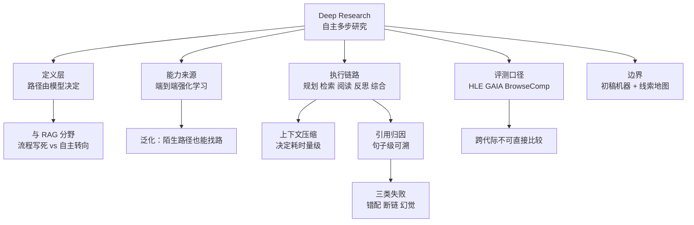

# Deep Research 总览

## 核心结论

Deep Research 的第一性判据只有一条：**路径由模型自己决定**。流程写死的系统，即便检索很多次，也不属于这一类。

它的能力来源是**端到端强化学习**，而非人写的 workflow——所以它在没设计过的路径上也能自己找路，这才是它与检索增强生成的分野所在。

站位可以压成一句：**当研究助手用挺合适，当答案机器用会出事**。它换的是调研这件事的承担者，从人来查、人来写，变成模型自主查、人来做判断。

## 要点拆解

### 定义层：四要素与一条判据

自主多步研究含四个要素，缺一不可：

| 要素 | 含义 |
|---|---|
| 自主规划 | 模型自己决定下一步查什么，而非执行预设步骤 |
| 多步检索 | 数十次到上百次搜索，构成一条轨迹而非单次查询 |
| 交叉验证 | 对同一事实从多个来源比对，而非单点采信 |
| 可溯交付 | 结构化长报告，且论断可点回具体出处 |

完整定义与判据见 [[Deep Research定义]] 与 [[DeepResearch与RAG分野]]。该能力由 OpenAI 于 2025 年 2 月首次以「Deep Research」命名发布，底座为 o3 早期版本。

### 能力层：为什么换训练方式

关键差异在训练方式。官方口径明确说明使用端到端强化学习，训练任务即真实世界的浏览与推理任务，模型由此学会规划多步轨迹、在无效路径上回退、根据实时读到的内容改变策略。

与手写 workflow 的本质差别是**泛化能力**而非步骤多寡。这一判断有开源侧独立佐证——在真实网页环境做强化学习的方案，显著优于提示词工程基线与基于固定语料库的强化学习方案。详见 [[端到端强化学习研究]]。

### 执行层：五步循环与压缩

一次研究可拆为规划、检索、阅读、反思、综合五步循环，反复执行至模型判断材料足够。循环终止条件由模型自行判定，没有固定轮次上限。

放开轮次必然带来上下文膨胀，数十个网页全文无法塞入窗口，因此链路中必须有压缩环节，把已读内容提炼为证据笔记。这直接决定了耗时量级差异——OpenAI 单任务通常 5–30 分钟，速度导向方案可在 3 分钟内交付，二者是设计取舍而非优劣。详见 [[研究执行链路]]。

### 归因层：带引用不等于可信

真正有价值的是**句子级引用**，每个论断可点回原始出处的具体段落，而非仅给出域名或首页链接。三类归因失败需分别处置：错配（最难发现，链接点得开）、断链（最常见）、幻觉（最危险，直接删除）。

人工核对一条引用可固化为四步：点开链接 → 定位段落 → 读上下文确认支持关系 → 查来源属性。详见 [[句子级引用归因]]。

### 评测层：分数领先但要小心口径

当前公认考卷有三张：HLE（专家级知识，26.6%）、GAIA（真实世界任务，pass@1 67.36%、cons@64 72.57%）、BrowseComp（首发未公布）。

值得注意的是最难层级提升最大——GAIA Level 3 从 42.31 升至 58.03，而 Level 3 恰需多步推理与跨源综合。但**分数依赖工具配置、尝试次数与题库版本，跨时间跨厂商直接比较会得出错误结论**。详见 [[DeepResearch评测基准]]。

### 边界层：能做与不能做

| 能做 | 不能做 |
|---|---|
| 跨多个来源综合信息 | 实时性，单次数分钟至半小时 |
| 产出有结构的长报告 | 墙后内容，付费墙与登录墙之后读不到 |
| 每条论断可溯源到原文 | 权威性判断，官方亦承认难以区分权威来源 |
| 附带数据计算与图表 | 替代人的最终判断 |

三个风险分别是幻觉与来源错配、成本与时延、评估口径不可比。第三条的处置最实用：拿自己领域的十个真实问题建小测集，用同一口径测量，比看任何公开榜单都可靠。详见 [[DeepResearch能力边界与风险]]。

## 相关页面

- [[DeepResearch与RAG分野]]：同品类最易混淆的对照，判据是路径由谁决定
- [[DeepResearch路线对比]]：四家厂商与开源方案的取舍横评
- [[DeepResearch开源复现]]：DeepResearcher / WebThinker / ASearcher 三条路线
- [[Agent循环]]：自主决策循环的通用形态，Deep Research 是其长时程变体
- [[Agent轨迹评估与结果评估·素材摘要]]：长时程轨迹的质量评估方法
- [[Deep Research·素材摘要]]：本文素材的一页式要点

## 参考来源

- [[raw/papers/Deep Research.md]] —— 本页编译所依据的论文格式素材
