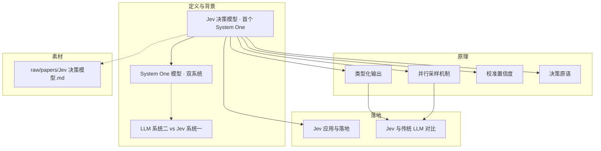

# Jev 决策模型总览

> 本页是进入 Jev 知识网络的**总入口**，梳理该模型的完整图谱与各维度页面的导航关系。

## 是什么

Jev 是 TypeSafe AI 于 2026-09-15 发布的**首个 System One 模型**，对应卡尼曼双系统理论中的「系统一」（快速、直觉、自动化反应）。它与传统 LLM 的根本差异是：**LLM 产出的 是人看的文本，Jev 产出的是给程序用的判断**。详见 [[System One 模型]]、[[Jev 决策模型]]。

## 为什么需要它

生成式 LLM 与机器决策存在结构性错配：LLM 是自回归文本生成器，「生成文本再解析」既慢又贵又易错；而 RLHF 把 LLM 塑成了「讨好人类的聊天机器」，机器间通信本不需自然语言。因此 TypeSafe 提出分工：LLM 管开放推理创作，Jev 管高频有界的原子决策。详见 [[System One 模型]] 与 [[Jev 与传统 LLM 对比]]。

## 核心原理

- **类型化输出**：答案被约束在预定义类型内，官方称类型层面「不会产生幻觉」。见 [[类型化输出]]。
- **并行采样**：所有答案一次前向计算并行产生，非逐 token 自回归。见 [[并行采样机制]]。
- **校准置信度**：每个决策带概率，软件据此自动执行或转人工。见 [[校准置信度]]。
- **决策原语**：Choice / Score / Boolean(Noul) 三种可混用原语。见 [[决策原语]]。

## 性能与成本

- 延迟 70~500ms；输入 $0.042/百万 token，输出免费。
- 厂商称 193.6x 快、444.6x 便宜；独立实测约 25x、580x。**区分口径**，见 [[Jev 与传统 LLM 对比]]。

## 适用场景与落地

集中在 Agent 决策节点（工具选型/完成判据/风险拦截/验证）与批量结构化判断，甜蜜点是「答案有边界 + 判断量很大」。见 [[Jev 应用与落地]]。

## 局限与待验证

不擅长开放生成、隐藏推理需拆分、权重未开放且独立校准数据稀少。见 [[Jev 应用与落地]] 与素材摘要 [[Jev决策模型·素材摘要]]。

## 全景导航

## 相关页面

- 实体：[[Jev 决策模型]]、[[TypeSafe AI]]
- 概念：[[System One 模型]]、[[类型化输出]]、[[并行采样机制]]、[[校准置信度]]、[[决策原语]]
- 对比：[[Jev 与传统 LLM 对比]]
- 落地：[[Jev 应用与落地]]
- 素材摘要：[[Jev决策模型·素材摘要]]