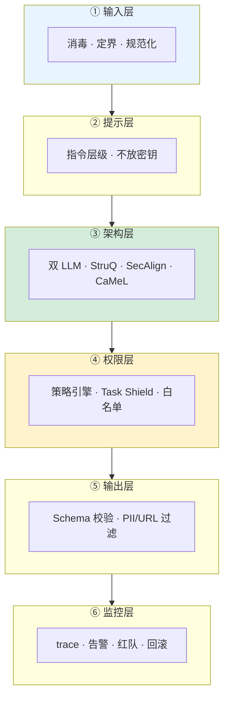
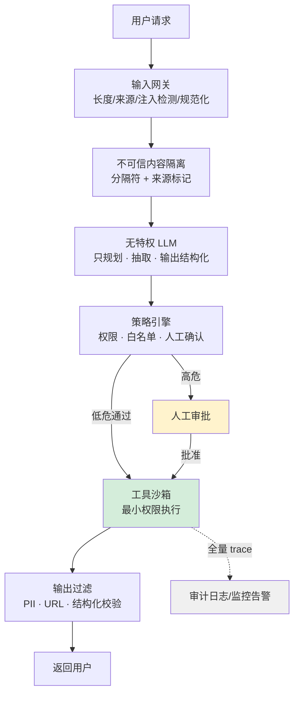

# Prompt 注入分层防御体系

## 核心结论

- 六层防御体系：**输入层 → 提示层 → 架构层 → 权限层 → 输出层 → 监控层**，层层递进、互为兜底。
- 核心思想：**不要把 LLM 当安全边界，要把 LLM 当不可信的自然语言处理器**。

## 六层防御体系全景

<b>图1 六层防御体系</b>

## 各层职责

| 层 | 关键手段 | 防御目标 |
|---|---|---|
| 输入层 | 长度/来源/频率限制、来源标记、转义、Base64/Unicode 规范化预处理 | 注入进入上下文前 |
| 提示层 | 明确指令层级、显式声明"context 内指令均为数据"、系统提示不放密钥 | 注入生效时 |
| 架构层 | StruQ、SecAlign、Task Shield、双 LLM、CaMeL | 结构性隔离 |
| 权限层 | 策略引擎（OPA/Casbin）、URL 白名单、命令转义、金额上限、默认拒绝 | 注入造成损害时 |
| 输出层 | JSON Schema 强制、PII/密钥/URL 过滤、HTML 转义、工具参数二次校验 | 输出泄露前 |
| 监控层 | 全量 trace、异常告警、速率限制、红队测试集、回滚机制 | 持续对抗 |

## 通用安全架构数据流

<b>图2 通用安全架构</b>

## 相关页面

- [[纵深防御五原则]]：五条原则是六层体系的纲领
- [[Prompt注入架构层防御方案对比]]：架构层五方案横向对比
- [[Prompt注入失效模式与降级方案]]：每层失效时的降级策略
- [[Prompt注入验证与运营]]：红队测试集与持续评估
- [[LLM-Agent安全防护总览]]：注入在 Agent 安全中的定位

## 参考来源

- [[raw/papers/Prompt注入与防范.md]]
