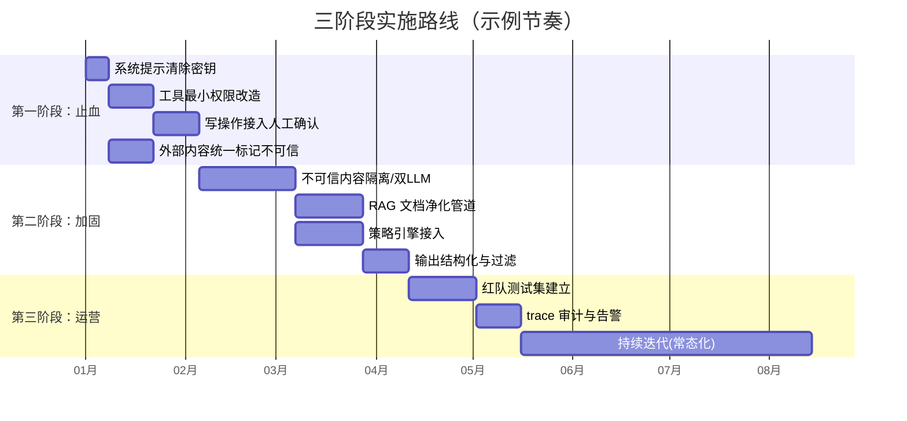

# Prompt 注入防御实施路线

## 核心结论

- 三阶段递进：**止血（消除最危险暴露面）→ 加固（结构性防御）→ 运营（持续对抗）**。
- 每阶段有明确的完成标志，攻防闭环运转才算落地。

## 三阶段实施路线

<b>图1 三阶段实施路线</b>

## 各阶段关键动作与完成标志

| 阶段 | 目标 | 关键动作 | 完成标志 |
|---|---|---|---|
| **一：止血** | 消除最危险暴露面 | 提示清密钥；最小权限；写操作人审；外部内容标记不可信 | 高危工具全部受限 |
| **二：加固** | 结构性防御 | 内容隔离；双 LLM/只读摘要；RAG 净化；策略引擎；输出过滤；影子模式验证 | 注入测试集拦截率达标，误报率低于阈值 |
| **三：运营** | 持续对抗 | 红队；全量 trace；告警/限流/回滚；**失效演练（chaos 测试降级路径）**；持续更新 | 攻防闭环运转，降级路径经过实测 |

## 相关页面

- [[Prompt注入分层防御体系]]：六层防御体系全景
- [[纵深防御五原则]]：五条原则是实施路线的纲领
- [[Prompt注入失效模式与降级方案]]：第三阶段失效演练的具体内容
- [[Prompt注入验证与运营]]：第三阶段运营闭环的工具与指标
- [[Prompt注入防御成本与误报权衡]]：各措施的成本与效用对比

## 参考来源

- [[raw/papers/Prompt注入与防范.md]]
