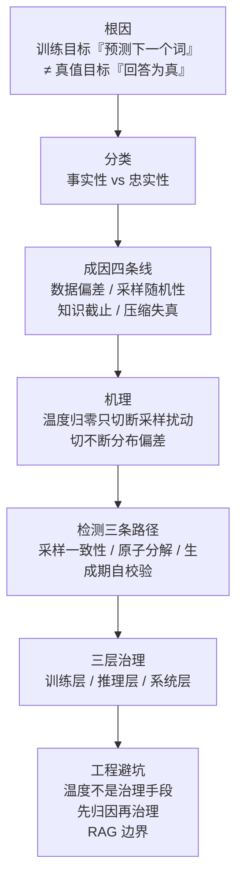

# 大模型幻觉技术全景总览

## 核心结论

大模型幻觉是**当前范式的固有属性，不是可以修掉的 bug**。模型的学习目标是预测下一个词元、隐含判准为语言合理性；用户的真实诉求是获取正确回答、判准为事实正确性，二者高度相关而不等价，落差之处即为幻觉。它在温度归零的贪心解码下仍稳定复现，因此治理的目标只能是**分层压制而非彻底消除**。

判断一份工程方案是否靠谱，只需问三个问题：**测了没有、归因了没有、分层了没有**。

## 七节主线

| 段 | 问题 | 落点页面 |
|---|---|---|
| 定义 | 幻觉的本质是什么 | [[大模型幻觉定义与本质]] |
| 分类 | 按什么基准切分 | [[事实性幻觉与忠实性幻觉]]、[[幻觉分类三套口径对比]] |
| 归因 | 是提示词还是模型的问题 | [[幻觉归因提示词与模型分诊]] |
| 成因 | 从哪来 | [[幻觉成因四条线]] |
| 机理 | 为什么调温度没用 | [[温度归零不消除系统性幻觉]] |
| 检测 | 怎么测 | [[幻觉检测三条路径]] |
| 治理 | 怎么治 | [[幻觉三层治理框架]] |
| 落地 | 怎么避坑 | [[大模型幻觉治理实践]]、[[RAG幻觉治理边界]] |

## 三条可直接用的结论

1. **调温度解决不了系统性幻觉**。温度归零只切断采样扰动这一路，切不断分布偏差这一路；若分布本身就把错误答案排在最高概率位，贪心解码会确定性、可复现地输出错误答案，详见 [[温度归零不消除系统性幻觉]]。
2. **RAG 补的是知识截止，不是忠实性**。检索解决「没听说过」，不自动解决「答非所问」；以源文档为锚的场景仍需单独度量忠实性，详见 [[RAG幻觉治理边界]]。
3. **测不到就治不了**。采样一致性、原子事实分解与生成期自校验分别覆盖在线、离线与流程内三种时机，三条路径互不替代，详见 [[幻觉检测三条路径]]。

## 与其它领域的关系

- [[Transformer总览]]：自回归解码结构是错误逐步累积的架构前提。
- [[温度参数与生成采样]]：本总览「温度」一段的机制本体。
- [[采样解码策略]]：贪心与采样的选择直接决定幻觉是偶发还是稳定。
- [[RAG检索优化五层]]：RAG 一侧的检索质量保障，是推理层治理的前置条件。
- [[LLM-Agent安全防护总览]]：幻觉治理与提示词注入防御同属可靠性工程，前者防「说错」、后者防「被骗」。

## 相关页面

- [[大模型幻觉成因与分层治理·素材摘要]]：本总览所依据的 raw 素材要点摘录。

## 参考来源

- [[raw/papers/大模型幻觉成因与分层治理.md]]
