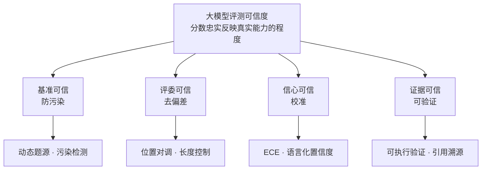

# 大模型评测可信体系总览

## 架构总览

<b>图1 大模型评测可信四支柱框架</b>

## 核心结论

- **评测可信度指评测结果忠实反映模型真实能力的程度**，可拆成四个可操作的问题：测的是什么（基准可信）、谁在打分（评委可信）、分数有多硬（信心可信）、凭什么说对（证据可信）[[大模型评测可信·素材摘要]]。
- 四者**并列且互不替代**：缺哪一环，评测结论都会与真实能力脱节 —— 这正是[[结构化垃圾场]]在评测侧的表现（分数漂亮但无决策价值）。
- **元认知先于方法论**：同一分数在不同榜单语境下含义不同 —— Chatbot Arena 以人类偏好投票为主、LiveBench 以客观 ground truth 自动判分为准、HELM 强调多维可复现的透明度量，三者取向不同、不可互替；单一分数只是候选信号，须逐项复核后方可采信。
- 四支柱均有已验证的工程落地路径，也各有明确边界（见下表「局限」列）。

## 要点拆解

| 支柱 | 回答的问题 | 机制 | 代表方案 | 局限 |
|---|---|---|---|---|
| 基准可信 | 测的是什么 | 防污染 | [[LiveBench]] | 题源更新依赖人工或程序持续投入 |
| 评委可信 | 谁在打分 | 去偏差 | [[长度控制胜率]]、对调法 | 只剥离已知中介变量（如长度） |
| 信心可信 | 分数有多硬 | 校准 | [[语言化置信度]] | 事实回忆类已验证，推理/算术待检验 |
| 证据可信 | 凭什么说对 | 可验证 | [[RAGAS无参考指标]]、HELM 开源框架 | 引用溯源不适用数学与代码任务 |

- 失效链条上：静态基准污染使分数虚高、评委偏差使排名可被操纵、RLHF 后置信度失准产出高置信错误、生成内容缺证据使答案难以复核，四类通路最终都汇成「榜单失真」。
- 与既有评估体系的分工：本总览管**分数的可信度**（测量本身靠不靠得住），[[Agent评估体系总览]]管**评估对象与方法选型**（评什么、用什么评），[[LLM-as-a-Judge]] 是评委可信支线中被动打分器的定位，[[人工评估与裁判校准]]提供人工锚点。
- 前沿方向上，评测正从单轮静态问答转向长时程任务，防污染与可验证仍是其设计主线。

## 相关页面

- [[大模型评测可信·素材摘要]]：本总览的原始素材要点索引
- [[基准污染与动态基准]]、[[TS-Guessing污染检测]]：基准可信支线的机理与检测手段
- [[LLM评委偏差与去偏差]]、[[长度控制胜率]]：评委可信支线的偏差谱系与定量方案
- [[置信度校准与ECE]]、[[语言化置信度]]：信心可信支线的度量与恢复手段
- [[可验证性四通道]]、[[RAGAS无参考指标]]：证据可信支线的四条通道与指标实现
- [[LiveBench]]：防污染侧的代表基准
- [[Agent评估体系总览]]：评估对象—方法—指标—维度—组合策略五层体系
- [[LLM-as-a-Judge]]、[[人工评估与裁判校准]]、[[四类评估方法对比]]：裁判范式与人工校准的既有沉淀
- [[RAG准确率保障体系]]、[[RAG界面溯源设计]]：输出可信与可核验在 RAG 侧的对应实践

## 参考来源

- [[raw/papers/大模型评测可信.md]]
