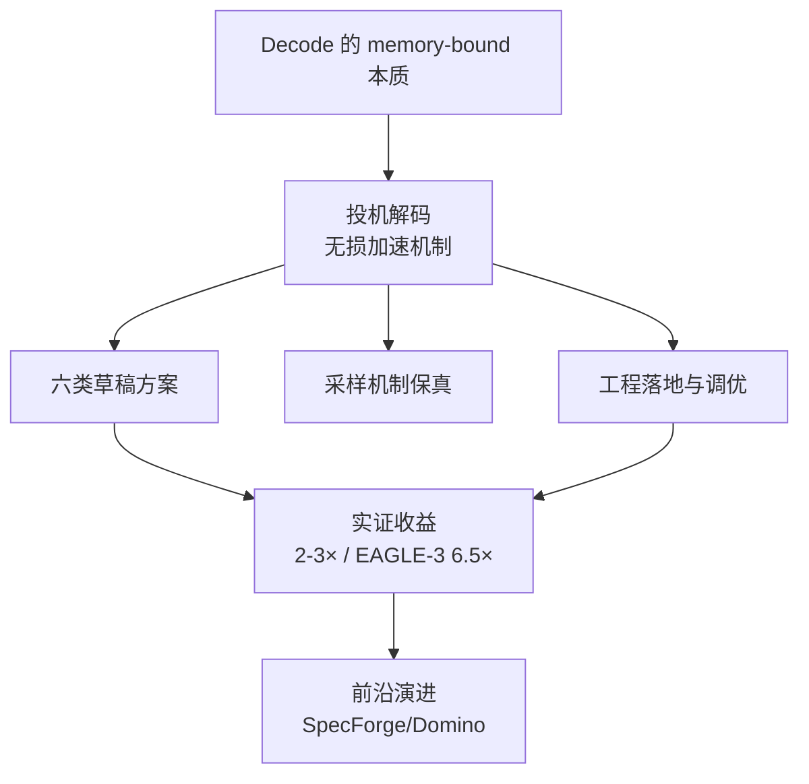

# 投机解码技术全景总览

## 全景定位

投机解码（Speculative Decoding）是**面向 Decode 阶段**的推理加速技术，与 KV Cache、量化、算子优化等正交叠加。它解决的核心问题：Decode 受显存带宽限制、GPU 算力闲置，但每个 token 都要搬运全量权重。

## 核心脉络

### 1. 问题与动机
自回归 Decode 逐 token 生成、受显存带宽限制（memory-bound），每步只产出 1 个 token 却搬运全量权重。核心洞察：**并行验证 K 个候选与逐一生成本相同**。

### 2. 机制：草稿-验证-重采样
- 草稿模型抢先起草一串候选。
- 目标模型一次前向并行验证。
- 按 `min(1,q/p)` 逐位接受，拒绝处从修正分布 `∝max(0,q-p)` 重采样。
- **不改变输出分布** → 无损加速。详见 [[投机解码采样机制]]。

### 3. 草稿六类画像
独立草稿模型 / 附加预测头（[[Medusa]]·[[EAGLE]]） / 模型内置 [[MTP多Token预测]] / 无模型草稿 / 部分层 LayerSkip / 树形投机。详见 [[草稿模型分类]]。

### 4. 工程落地
主流引擎已内置：vLLM `--speculative-model`、SGLang `--speculative-algorithm EAGLE3`；调参落草稿长度 K（4–8）、树宽、验证预算；**接受率是生命线**（40%–80% 健康区间、低于 50% 趋净负）；与量化/PagedAttention/CUDA Graph 正交叠加。详见 [[投机解码工程落地]]。

### 5. 实证与趋势
原始方案 2–3×，EAGLE-3 五项任务最高 6.5×、较 EAGLE-2 提升约 1.4×。草稿训练走向系统化：[[SpecForge]] 统一流水线，DFlash/Domino 等新算法持续刷新接受率与加速。

## 与既有技术栈的关系

投机解码作用于 **Decode 的访存摊薄**，与以下技术在目标层面正交、可叠加：

| 技术 | 与投机解码的关系 |
|------|------------------|
| KV Cache / PagedAttention | 优化显存、放大 batch，投机解码在其上叠加 |
| 量化（FP8/INT4） | 压缩权重传输、降低访存压力 |
| CUDA Graph / FlashAttention | 降低 kernel 启动与开销 |
| 采样解码策略 | 投机解码保持与既有采样一致的输出分布 |

## 相关页面

- [[投机解码]]：机制主概念
- [[草稿模型分类]]：草稿方案谱系
- [[投机解码工程落地]]：工程实践
- [[投机解码·素材摘要]]：素材要点摘录
- [[KV Cache优化技术栈总览]]：正交叠加的另一条优化栈

## 参考来源

- [[raw/papers/投机解码.md]]