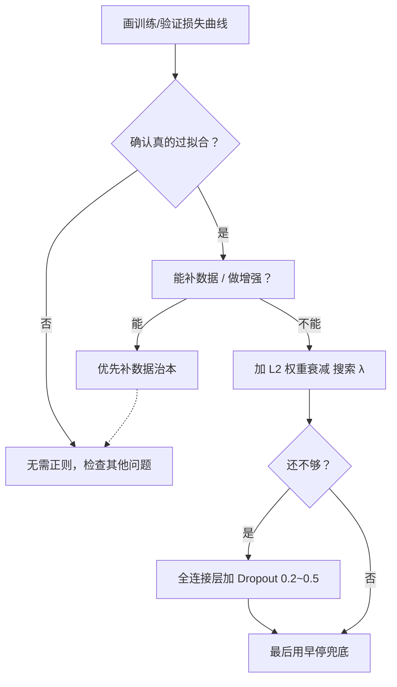

# 正则化工程实践

## 核心结论
- 应对 [[过拟合|过拟合]] 有四类路线：**参数约束、结构干预、数据扩充、集成与结构限制**——先确认真的过拟合，再选与场景匹配的手段。
- 调参核心：λ 靠交叉验证；**先标准化、只罚 $w$ 不罚 $b$、Adam 必配 AdamW**。
- 三句话：对症下药、由诊断确定强度、不可盲目堆叠。

## 四类技术路线选型

| 类别 | 代表手段 | 机制 | 典型场景 |
|------|---------|------|---------|
| 参数约束 | L1（[[L1正则与LASSO]]）/ L2（[[L2正则与权重衰减]]）/ [[弹性网络]] | 损失加惩罚 | 特征筛选 / 通用正则 |
| 结构干预 | [[Dropout]] / [[提前停止EarlyStopping]] / [[批量归一化与正则化]] / 权重约束 / 标签平滑 | 改造网络 | 深度网络/Transformer |
| 数据扩充 | [[数据增强与噪声注入]] / 合成更多 | 源头降方差 | 视觉/文本 |
| 集成与结构限制 | Bagging / 限宽度深度 / 剪枝 | 平均与缩假设空间 | 传统 ML |

## 诊断驱动的实施顺序

图1 诊断驱动的正则化实施顺序

> 图为单一路径引导；实际叠加需对照方法冲突——如标签平滑损蒸馏、BN 正则在 batch 增大时减弱。

## 三条铁律
1. **先标准化**：L1/L2 前特征必须标准化，否则惩罚被大量纲特征主导。
2. **只罚 $w$ 不罚 $b$**：偏置只平移不弯曲曲面，罚它无方差收益。
3. **Adam 必配 AdamW**：SGD 下「权重衰减≡L2」在 Adam 下失效，需 [[AdamW与权重衰减解耦]] 解耦。

## 常见陷阱
- λ 过强→欠拟合（训练测试同时变差）；正则救不了数据不足。
- 特征高度相关：L1 只随机选其一，改用弹性网络。
- 现代 LLM 微调（[[微调与RAG分工]]）默认权重衰减 + AdamW 即参数约束路线在工程上的落地。

## 相关页面
- [[正则化]]：概念总入口
- [[过拟合]] / [[偏差-方差权衡]]：问题与理论基座
- [[L1正则与LASSO]] / [[L2正则与权重衰减]] / [[弹性网络]] / [[Dropout]] / [[提前停止EarlyStopping]] / [[批量归一化与正则化]] / [[数据增强与噪声注入]]：各手段详情
- [[AdamW与权重衰减解耦]]：优化器侧铁律
- [[正则化·素材摘要]]：本页的素材要点索引与溯源锚点。
- [[贝叶斯与优化视角正则化]]：本页的素材要点索引与溯源锚点。

## 参考来源
- [[正则化]]