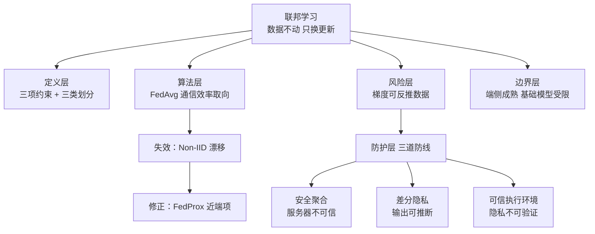

# 联邦学习总览

## 核心结论

联邦学习的第一性定义只有一句：**数据不动，只交换模型更新**。

它换的是数据流动的方式，但**不提供免费的隐私**——梯度本身会泄露信息，必须叠加密码学或扰动机制才有真实保障。

站位可以压成两句：**端侧窄任务已经工程可用；通用大模型训练因端侧算力与数据规模错配，短期难以覆盖。**

## 要点拆解

### 定义层：三项约束决定成败

| 约束 | 为什么关键 |
|---|---|
| 数据不出域 | 隐私前提，失效则范式无意义 |
| 隐私可量化 | 「没上传」不等于「没泄露」 |
| 通信可行 + 容忍异构 | 移动网络带宽稀缺、设备能力不齐 |

完整定义与三类划分见 [[联邦学习]] 与 [[横向联邦与纵向联邦]]。

### 算法层：核心贡献是通信效率

[[FedAvg联邦平均]] 的加权平均只是表层形式，真正的设计目标是**把计算下沉、把通信压最低**——K 步本地训练是核心参数，通信轮次与本地计算量之间存在明确的权衡关系。

同期另一路线从「减少单次上传体积」入手，用结构化更新与草图压缩传输量，与 FedAvg 的「减少轮次」互补。

### 风险层：被低估的一个事实

[[梯度泄露攻击]] 证明仅凭共享梯度即可重建训练数据，直接推翻了「不上传数据就安全」的直觉。这是理解全部防护设计的前提。

### 防护层：三道防线分工明确

| 防线 | 解决什么 | 局限 |
|---|---|---|
| [[安全聚合SecAgg]] | 服务器不可信 | 聚合结果仍可被推断 |
| [[差分隐私]] | 输出可被推断 | 信任位置与精度代价需权衡 |
| 可信执行环境 | 隐私不可验证 | 硬件漏洞假设与开销 |

三者互补而非替代——单上任何一层都不足以构成完整防护。

### 边界层：什么场景值得用

| 判断维度 | 适合 | 不适合 |
|---|---|---|
| 数据位置 | 天然分散在端侧或机构内 | 本可合法集中 |
| 任务范围 | 窄任务、单点预测 | 需海量多样数据的通用大模型 |
| 算力条件 | 端侧可承担本地训练 | 端侧算力不足 |
| 合规压力 | 强合规、不可集中 | 无合规约束、追求极致效率 |

判定路径：先问数据能否合法集中，再问隐私保障施加在哪一层——两个答案共同决定是否采用联邦学习。

### 落地现状

- **已成立**：生产系统能协调数百万台设备参与训练，安全聚合与差分隐私已进入正式流水线。
- **仍受限**：规模错配（端侧无法承载大模型）、系统复杂度（同步协议协调困难）、隐私不可独立验证、女巫攻击（恶意方控制多个身份扭曲聚合）。

## 相关页面

- [[联邦学习]]：核心概念页（定义、约束、分类）。
- [[FedAvg联邦平均]]：基础聚合算法。
- [[FedProx近端优化]]：Non-IID 漂移的修正。
- [[安全聚合SecAgg]]、[[差分隐私]]、[[梯度泄露攻击]]：风险与三道防线。
- [[横向联邦与纵向联邦]]：三类划分的横向对比。
- [[LLM-Agent安全防护总览]]：同为隐私与安全防护体系，可对照其纵深防御思路。

## 参考来源

- [[raw/papers/联邦学习.md]]（编译主源，8 条参考文献）
- 线上原文：[https://arxiv.org/abs/1602.05629](https://arxiv.org/abs/1602.05629)
- 线上原文：[https://arxiv.org/abs/2410.08892](https://arxiv.org/abs/2410.08892)
- [[联邦学习·素材摘要]]：本页对应的素材要点索引
