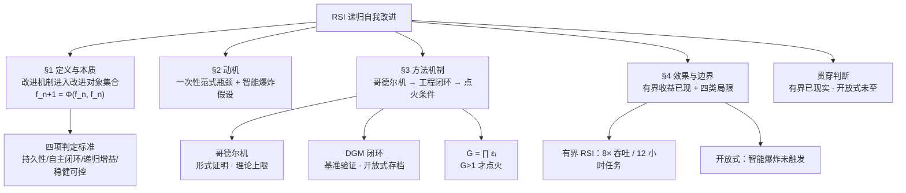

# 递归自我改进总览

## 核心结论

RSI 的全部判断可以压缩成一句话：**只看它改的是不是「产生能力的机制」**。

- 改输出、改记忆、改局部代码 → 自我改进，收益一次性；
- 改改进机制本身、且跨代复利 → 递归自我改进，理论上指数增长。

**现实站位**：有界 RSI 已经成立（Claude 自写代码、8 倍研发吞吐、12 小时任务），但因为反馈环弹性乘积 $G$ 未跨过 1，看到的一律是线性加速；**指数级的智能爆炸尚未触发**。

## 要点拆解

### 判据：多出的那个参数

Yampolskiy 的形式化把「递归」的数学含义说得很干净：

$$f_{n+1}=\Phi(f_n,f_n) \quad \text{而非} \quad f_{n+1}=\Phi(f_n)$$

改进机制进入改进对象集合，就是那第二个 $f_n$。展开见 [[递归自我改进RSI]]。

### 三道闸门：怎么判断一个系统算不算

| 闸门 | 问题 | 不过关的后果 |
|---|---|---|
| ① 持久性 | 重启后改进还在吗 | 退出自我改进层 |
| ② 自主闭环 | 人离开一周它还能迭代吗 | 退出自主性，变成人工流水线 |
| ③ 递归增益 | 第 N+2 代设计周期更短了吗 | 降级为有界 RSI |
| ④ 稳健可控 | 第 N 代目标还等于第 0 代吗 | 增益不可持续，滑向对齐退化 |

逐条拆解与工程检查法见 [[RSI四项判定标准]]，第 ③ 条的分层后果见 [[有界RSI与开放式RSI]]。

### 理论框架与工程实现的分野

| | 哥德尔机 | DGM |
|---|---|---|
| 改写依据 | 形式证明「效用严格更优」 | 基准测试经验验证 |
| 保证强度 | 全局最优、无局部极值 | 无最优性保证 |
| 可运行性 | 理论框架 | 实际可跑 |
| 补救手段 | — | 基准门槛/回归保护/多评估器交叉/回滚 |

**这条分野是理解 RSI 工程现状的关键**：理论给了上限，工程用冗余验证去逼近它。详见 [[哥德尔机]]。

### 点火条件：唯一的量化阈值

$$G=\prod_{i=1}^{n}\epsilon_i$$

$G>1$ 进入自我维持加速，$G<1$ 逐轮衰减。当前估算显示反馈环尚不足自我维持加速但正在增强。

**乘积结构带来一个重要推论**：整体受最慢环节锁住，所以提升 RSI 可行性最有效的路径常是补最弱一环，而非把最强一环做得更强。详见 [[点火条件与复利因子G]]。

### 四类局限与适用边界

| 局限 | 内容 |
|---|---|
| 研发收益递减 | 弹性乘积未跨 1，仍处衰减区 |
| 物理与算力瓶颈 | 算法需算力兑现、软件需部署验证、材料需制造测试，受最慢环节锁住 |
| 验证比实现难 | 系统既是被改进者又影响评估，易滑向奖励黑客 |
| 对齐退化 | 微小偏差跨代放大，自主构建后继者使传统保护手段面临根本挑战 |

**先行落地边界**：规则明确、反馈可自动验证的封闭域（算法发现、代码修复、芯片设计）。目标选择、问题定义等需人类判断力的环节，仍存在明显能力鸿沟。

### 一组值得记住的数字

| 观测 | 数值 |
|---|---|
| 研发吞吐 | 2026 Q2 工程师人均日合并代码量达 2024 年 8 倍；约 130 人调研中位数估约 4 倍产出 |
| 长时程自主性 | 任务时长约每四个月翻倍，从约 4 分钟增至约 12 小时 |
| 代码自主率 | 截至 2026-05，Anthropic 代码库超 80% 合并代码由 Claude 完成，开放档位会话成功率 76%、半年 +50pp |
| 代码审查 | 自动化 Claude 审查可拦截约三分之一导致 claude.ai 历史事故的缺陷 |
| 任务级反思 | Self-Refine 7 项任务平均提升约 20%；Reflexion HumanEval 91% pass@1（超 GPT-4 基线 80%） |

这些数字全部属于**有界 RSI 的线性加速证据**，不构成智能爆炸的证据——这一读法是本页最重要的使用提醒。

## 相关页面

- [[递归自我改进RSI]]：定义、形式化与概念边界。
- [[RSI四项判定标准]]：四项闸门的逐条拆解。
- [[有界RSI与开放式RSI]]：复利是否成立带来的本质分层。
- [[点火条件与复利因子G]]：唯一量化阈值的推导与读法。
- [[哥德尔机]]：理论框架与 DGM 工程转向。
- [[Agent训练方法阶梯]]：Agent 能力三级阶梯，其 L3 持续自我改进是 RSI 的工程前身。
- [[Agent评估体系总览]]：RSI 依赖的基准验证与评估方法论。
- [[机器学习安全四大类别]]：对齐退化与奖励黑客的上位风险树。

## 参考来源

- [[raw/papers/RSI递归自我改进.md]]（编译主源，9 条参考文献）
- 线上原文：[https://www.anthropic.com/institute/recursive-self-improvement](https://www.anthropic.com/institute/recursive-self-improvement)
- 线上原文：[https://arxiv.org/abs/2609.15802](https://arxiv.org/abs/2609.15802)
- 线上原文：[https://arxiv.org/abs/2505.22954](https://arxiv.org/abs/2505.22954)
- [[RSI递归自我改进·素材摘要]]：本页对应的素材要点索引
