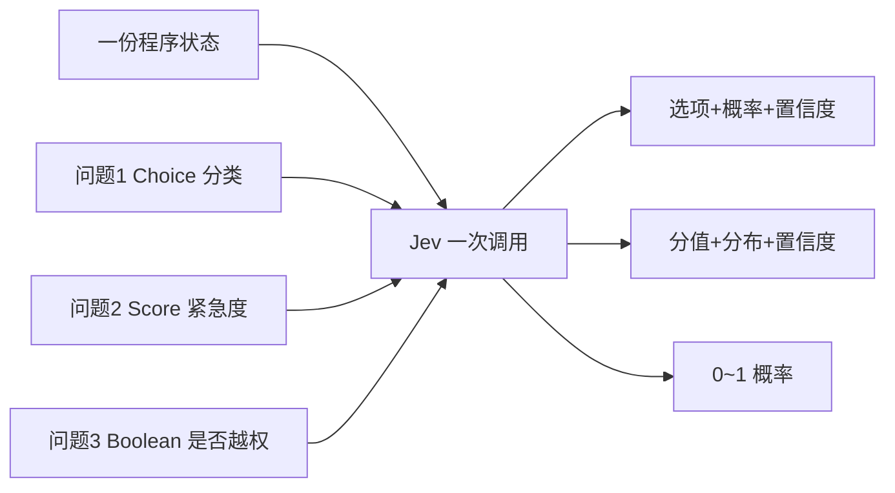

# Jev 决策模型 · 素材摘要

> 本文是对素材 [[raw/papers/Jev 决策模型.md]] 的知识压缩与要点提取，供 Wiki 检索与页面联动引用。观点一律区分**厂商口径**与**独立实测**。

## 一句话定位

Jev 是 TypeSafe AI 于 2026-09-15 发布的**首个 System One 模型**：输入一份程序状态 + 若干预定义问题，返回带校准概率的类型化决策，**不生成自然语言文本**。官方称其为「系统一」直觉判断在工业界的首次落地。

## 核心属性（四点）

1. **类型化输出**：答案被约束在开发者预定义的类型里，不写自由文本，官方称在类型层面「不会产生幻觉」。
2. **并行采样**：所有答案在一次前向计算中并行产生，而非逐 token 自回归。
3. **校准置信度**：每个决策带概率，软件据此判断自动执行还是转人工复核。
4. **面向机器的接口**：官方称为「更像代码」——可靠、快速、自洽、类型安全。

## 三种问题原语（可通过同一接口混用）

| 原语 | 回答什么 | 返回内容 |
|---|---|---|
| Choice | 从若干选项中选一个 | 选项、各选项概率、置信度 |
| Score | 在某个评分尺度上打分 | 分值、概率分布、置信度 |
| Boolean (Noul) | 一句陈述是否成立 | 0~1 的概率 |

## 设计动机

- 生成式 LLM 是自回归文本生成器，「生成文本再解析」慢、贵、易错——回答只需要「是/否/选哪个」的判断。
- RLHF 把 LLM 优化成了「讨好人类的聊天机器」，而机器间通信本不需自然语言。
- 分工主张：LLM 管开放推理创作，Jev 管高频有界的原子决策，互补而非替代。

## 性能与成本

- **延迟**：端到端 70~500 毫秒（厂商报告）。
- **定价**：输入 $0.042/百万 token，输出免费（响应只有几个字节结构数据）。
- **提速降本**：官网称 193.6x 快、444.6x 便宜（厂商自测）；第三方 Every 独立实测约 25x 更快、580x 更便宜；TypeSafe 自家四工作流基准得分 67.8%。

## 适用场景

- Agent 决策节点：工具选型、任务完成判据、风险拦截、结果验证。
- 客服分流、检索重排、引用支持判断、提示注入检测、内容审核、批量标注。
- 甜蜜点：答案有边界 + 判断量很大。

## 局限与待验证

- 不能写回复、总结、代码，不能开放规划；算术与精确字符串处理不可靠。
- 隐藏推理需拆分或交推理模型。
- 权重未开放（早期接入、仅文本输入）；独立校准数据稀少，厂商数字待验证。

## 开源生态

围绕它已出现用开源基座（Qwen3.5）+ LoRA + 指针头复现同形态决策接口的替代模型（Bosun/Kev/Nimble/Elephant/Mammoth/Drex），社区在整理 SDK、演示与独立评测。

## 相关导航

- 总览：[[Jev 决策模型总览]]
- 主概念：[[System One 模型]]、[[类型化输出]]、[[并行采样机制]]、[[校准置信度]]、[[决策原语]]
- 实体：[[TypeSafe AI]]、[[Jev 决策模型]]
- 对比：[[Jev 与传统 LLM 对比]]
- 落地：[[Jev 应用与落地]]

