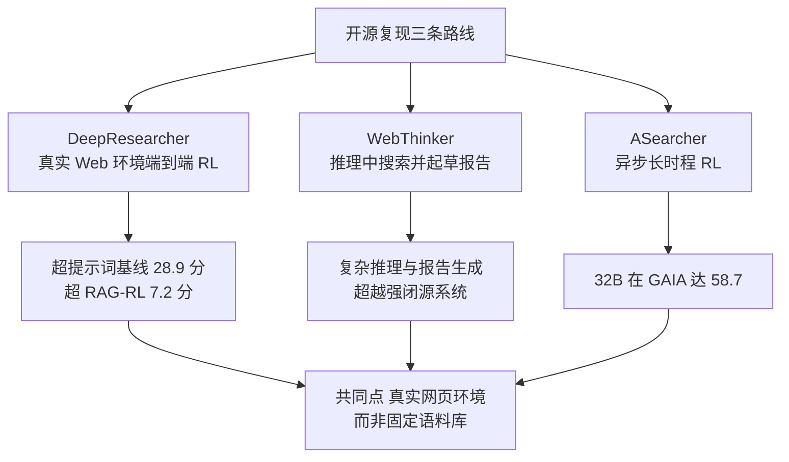

# DeepResearch开源复现

## 核心结论

复现路径已经打通，三条代表路线都在**真实网页环境**中做强化学习，而非在固定语料库内。

这一区别并非实现细节：固定语料库假设所有所需信息都在库内，而真实网页是嘈杂、动态、会变的。DeepResearcher 的结论是，**在真实环境训练是必要的而非可选的**。

## 要点拆解

### 三条路线

| 方案 | 思路 | 关键结果 |
|---|---|---|
| DeepResearcher | 真实 Web 环境端到端 RL | 超提示词工程基线 28.9 分，超基于 RAG 的 RL 7.2 分 |
| WebThinker | 推理过程中搜索并起草报告 | 在复杂推理与报告生成任务上超越强闭源系统 |
| ASearcher | 异步长时程 RL | 32B 模型在 GAIA 达 58.7 |

### 三条路线的侧重差异

| 方案 | 解决的问题 | 适合借鉴什么 |
|---|---|---|
| DeepResearcher | 训练环境真实性 | 环境搭建与奖励设计的最小可行方案 |
| WebThinker | 搜索与写作的耦合 | 研究过程中边查边写的交互结构 |
| ASearcher | 超长轨迹的训练效率 | 异步采样与长时程 RL 的工程实现 |

### 规模不是唯一变量

ASearcher 用 32B 模型在 GAIA 达到 58.7，高于闭源方案在部分配置下的成绩。这说明在这类任务上，**训练方法与环境质量的重要性不低于底座规模**。

### 复现的现实门槛

三条路线都以真实网页为环境，带来的门槛是：需要可用的搜索接口、稳定的爬取或浏览器环境、以及能承受长时程采样的训练资源。这是「能复现」与「能跑通生产」之间的差距所在。

## 相关页面

- [[端到端强化学习研究]]：为什么必须在真实环境训练
- [[DeepResearch路线对比]]：与闭源方案的取舍对照
- [[DeepResearch评测基准]]：GAIA 分数的口径
- [[Agent训练方法阶梯]]：训练方法的层级视角
- [[DeepResearch总览]]：领域入口页

## 参考来源

- [[raw/papers/Deep Research.md]]
