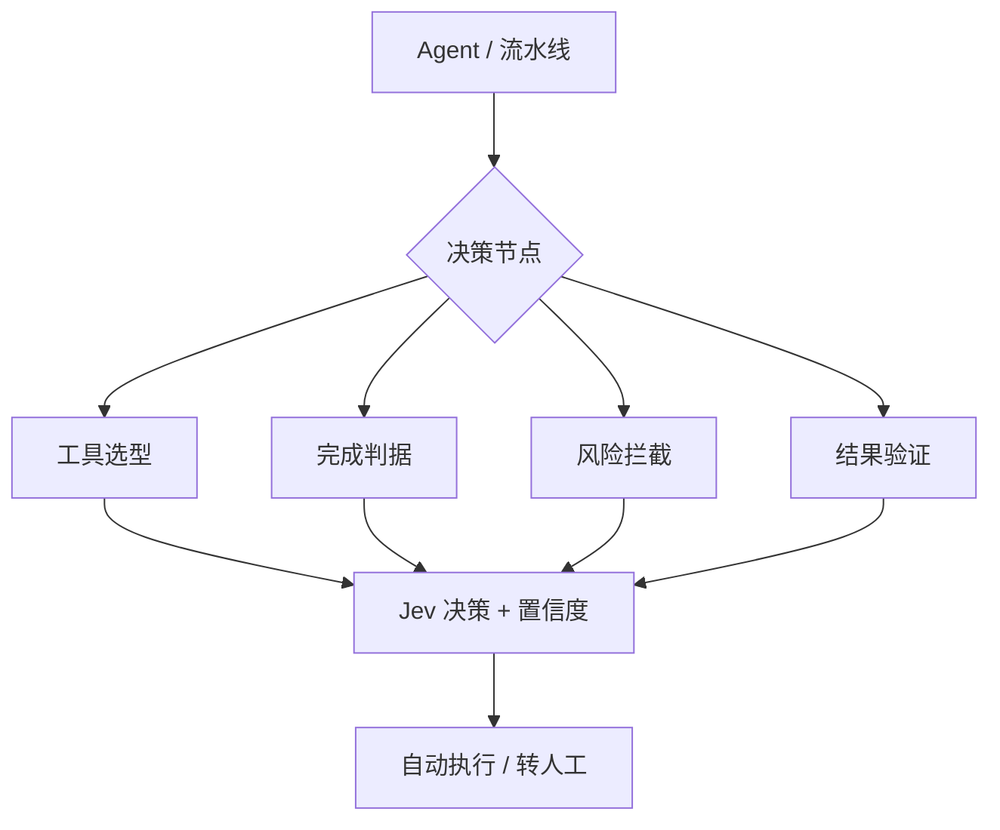

# Jev 应用与落地

## 高价值场景

- **Agent 决策节点**：工具选型、任务完成判据、风险拦截、结果验证——给 Agent 充当可依赖的判断点。见 [[校准置信度]]。
- **结构化判断与批量标注**：客服分流、检索重排、引用支持判断、提示注入检测、内容审核、批量标注。
- 社区还出现用 Jev 做模型路由、上下文压缩、代码工具等方向的实践。

## 甜蜜点

「**答案有边界 + 判断量很大**」的组合——那些只需一个「是/否/选哪个」的琐碎判断被高频复用。当调用变便宜，它就会被用在更多**原本不值得动用模型**的地方，这是 Jevons 式「智力成本下降导致智力泛用」的愿景。

## 局限与待验证

- **不擅长开放生成**：不能写回复、总结、代码，不能开放规划；算术与精确字符串处理不可靠。
- **隐藏推理**：几步内推理需拆成小问题或交推理模型；官方建议把复杂判断拆成几个明确问题再组合。
- **权重未开放**：早期接入（early access）、仅文本输入；独立校准数据稀少，性能数字多为厂商自测，是否为范式转变仍需验证。

## 开源替代生态

Jev 权重尚未开放，已出现用开源基座（Qwen3.5）+ LoRA 适配器 + 小型指针头（pointer head）复现同形态 Choice/Score/Noul 决策接口的替代模型：**Bosun**（Apache-2.0，0.6B/1.7B 权重）、**Kev**、**Nimble**、**Elephant 1 / Mammoth 1**、**Drex** 等。社区在整理 SDK、演示与独立评测。

> 素材信息不足，替代模型的详细能力对比见 raw 原文 [[raw/papers/Jev 决策模型.md]] 5.3 节。

## 相关导航

- 模型：[[Jev 决策模型]]
- 对比：[[Jev 与传统 LLM 对比]]
- 品类：[[System One 模型]]
- 总览：[[Jev 决策模型总览]]
- 素材摘要：[[Jev决策模型·素材摘要]]

