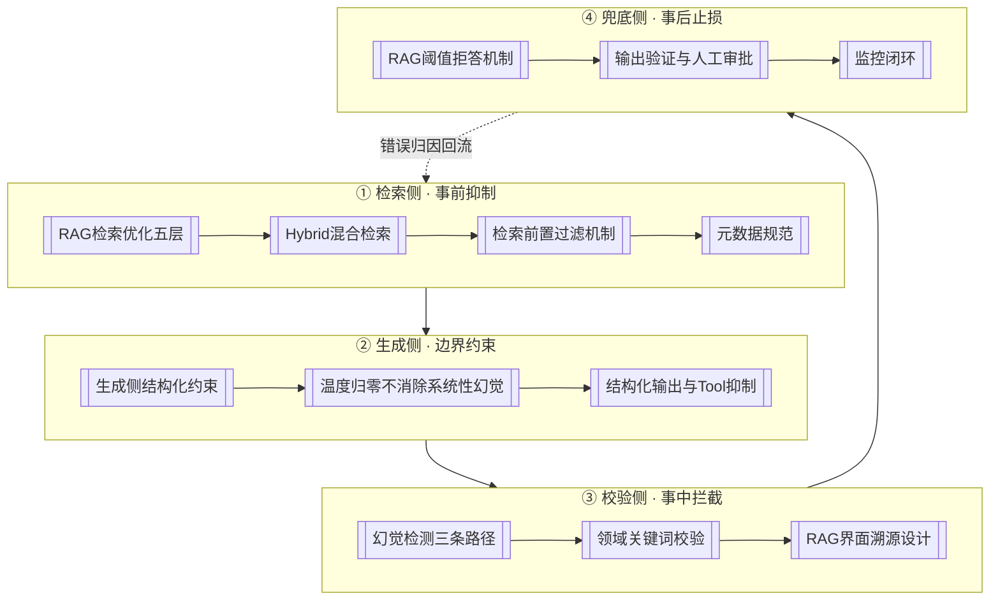

# RAG质量保障主题

## 全景图

## 核心结论

RAG 的质量不是一个"指标"，而是一条**从召回到生成再到复核的链路治理**。全库已有的 RAG 质量相关知识分散在四个侧面，本页把它们串成统一主线：

| 侧面 | 已有页面 | 在质量链路中的角色 |
|---|---|---|
| 检索侧 | [[RAG检索优化五层]]、[[Hybrid混合检索]]、[[检索前置过滤机制]]、[[向量库metadata过滤能力对比]] | 决定"能不能召回到正确的内容" |
| 生成侧 | [[生成侧结构化约束]]、[[温度归零不消除系统性幻觉]]、[[结构化输出与Tool抑制]] | 决定"会不会基于错误内容自由发挥" |
| 校验侧 | [[幻觉检测三条路径]]、[[领域关键词校验]]、[[RAG界面溯源设计]] | 决定"错误能不能被发现" |
| 兜底侧 | [[RAG阈值拒答机制]]、[[输出验证与人工审批]]、[[监控闭环]] | 决定"发现之后代价能不能控制住" |

**统一视角**：错误总是从上游往下游传，治理必须**越靠前越便宜**——检索侧的切片与混合检索是元级成本，生成侧的契约约束是毫秒级，校验侧的检测模型是推理成本，兜底侧的人工复核是人力成本。工程投入应按这条成本曲线从左到右优先补齐。

## 关键边界（避免歧义）

| 易混 | 澄清 |
|---|---|
| 质量 vs 权限 | 质量管"可不可信"，权限管"能不能看"，两者正交，见 [[RAG质量三道闸门对比]] |
| 幻觉治理 vs RAG 质量 | RAG 补知识截止，不自动解决忠实性，见 [[RAG幻觉治理边界]]；本页是在 RAG 之上补运行时校验 |
| 兜底层（同名） | [[大模型兜底层]] 指意图识别分层漏斗的最后一层，与本页"拒答/复核/日志"兜底**同名不同义** |
| 监控闭环 | 本页的日志用于**错误归因**（检索侧 or 生成侧），与运维监控不同，见 [[监控闭环]] |

## 待补齐的方向

本页以下环节目前 wiki 覆盖较薄，属于知识缺口：

- **切片质量评估**：切片策略（语义边界 + 重叠）如何量化评估、切多长合适，本库尚无专页；
- **阈值标定方法**：除离线标注 + A/B 的经验描述外，缺更系统的标定方法；
- **领域词库规模化**：仅 [[领域关键词校验]] 一页，缺行业化模板与维护流程；
- **拒答话术与用户体验**：拒答时的用户引导设计缺专页。

对应缺口已在 [[RAG质量保障主题]] 编译时识别，后续可从素材或实战中补齐。

## 相关页面

- [[RAG准确率保障体系]]：本次主题的主干页
- [[RAG准确率提升·素材摘要]]：本次主题的素材来源
- [[RAG质量三道闸门对比]]：与权限体系的边界辨析
- [[RAG绝对准确不可达]]：前提认知
- [[向量Embedding与向量数据库总览]]：检索侧的存储底座
- [[大模型幻觉技术全景总览]]：幻觉方向的领域总览
- [[大模型幻觉治理实践]]：幻觉治理的实战避坑

## 参考来源

- [[raw/papers/RAG准确率提升.md]]