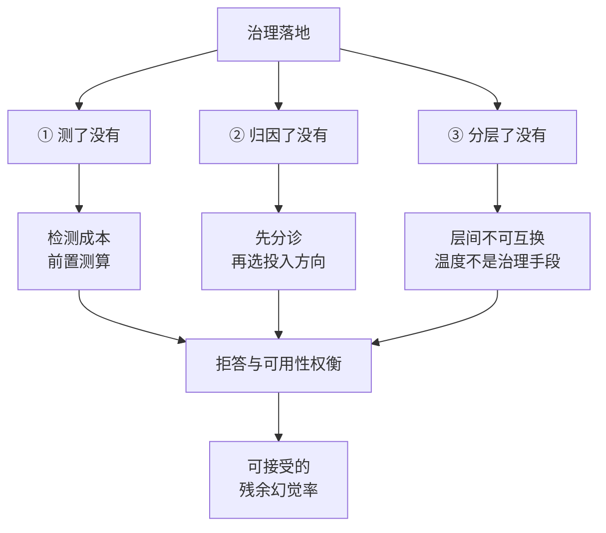

---
type: topic
source: "[[raw/papers/大模型幻觉成因与分层治理.md]]"
description: "大模型幻觉治理实践的六条工程避坑：温度不是治理手段、先归因再治理、RAG 边界、检测成本前置测算、拒答与可用性权衡、层间不可互换。"
created_at: 2026-10-11 23:12:03
updated_at: 2026-10-11 23:12:03
tags: [hallucination, engineering, pitfalls, practice, topic]
---

# 大模型幻觉治理实践

## 核心结论

工程落地判断一份幻觉治理方案是否靠谱，只需问三个问题：**测了没有、归因了没有、分层了没有**。六条避坑全部围绕这三问展开。

## 六条避坑

### ① 调温度解决不了系统性幻觉

温度 $T\to 0$ 只切断采样扰动这一路，切不断分布偏差这一路；若分布本身就把错误答案排在最高概率位，贪心解码会**确定性、可复现地**输出错误答案。

把温度调到 0 不是消除幻觉，是**把偶发幻觉换成稳定幻觉**，详见 [[温度归零不消除系统性幻觉]]。

### ② 先归因，再治理

在 prompt 上反复调优却治不好分布偏差，是工程里最常见的浪费。归因方法见 [[幻觉归因提示词与模型分诊]]：改写提示词后幻觉消失 → 投 prompt 工程；多种提示词下持续 → 投模型治理。

**归因错误的成本远高于归因本身。**

### ③ RAG 不是万能药

RAG 补的是知识截止，不自动解决忠实性。检索解决「没听说过」，不自动解决「答非所问」。以源文档为锚的场景仍需单独度量忠实性，详见 [[RAG幻觉治理边界]]。

### ④ 检测成本要前置测算

SelfCheckGPT 的多次采样、FActScore 的检索比对、CoVe 的自校验循环——三条检测路径都有明确成本。上线前必须回答：**这部分延迟与费用由谁承担、在哪个环节承担**。

### ⑤ 拒答与可用性是一对权衡

拒答训练让模型学会说「不知道」，直接降低幻觉率；但拒答率过高会损害可用性，用户宁可要一个「大概对」的答案也不要一句「我不知道」。

**拒答阈值是产品决策，不是技术决策**，需要按业务场景单独调，详见 拒答训练。

### ⑥ 层间不可互换

| 错配 | 后果 |
|---|---|
| 用系统层手段治根因 | 上线一堆过滤器，分布照旧偏 |
| 用训练层手段治表征 | 等几个月重训，问题却出在检索没做好 |
| 只上推理层不上系统层 | 一次检索失败直接穿透到用户 |

三层的分工与边界见 [[幻觉三层治理框架]]。

## 相关页面

- [[幻觉三层治理框架]]：分层的完整依据。
- [[幻觉检测三条路径]]：④的三条候选路径。
- 拒答训练：⑤的核心手段。
- [[大模型幻觉技术全景总览]]：本主题所属的领域全景。

## 参考来源

- [[raw/papers/大模型幻觉成因与分层治理.md]]
